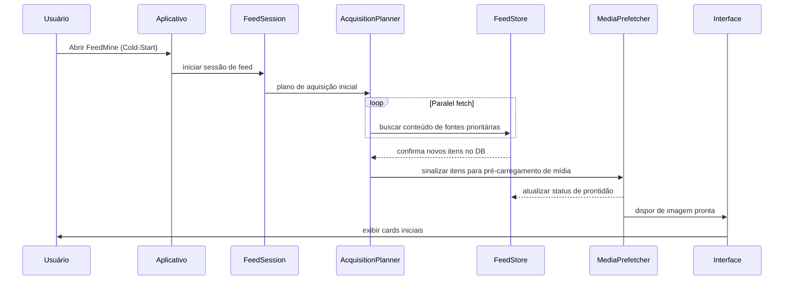
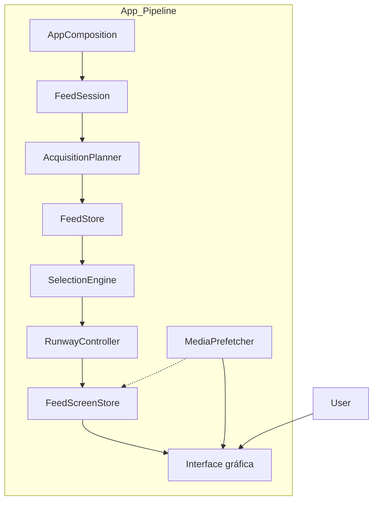

# Especificação do FeedMine V2: Cold-Start, Produção Contínua e Estabilidade de UI

## Resumo Executivo  
Este relatório analítico examina o estado atual do FeedMine V2, compara-o com a implementação anterior (V1) e propõe especificações e melhorias focadas em: **arranque a frio (cold-start)** do feed, produção contínua de conteúdo e estabilidade da interface. Identificamos lacunas críticas – como baixa concorrência inicial, falta de pontuação na seleção de fontes, ausência de callbacks de pré-carregamento de mídia e gatilhos de produção limitados – que impactam negativamente a experiência do usuário. Cada lacuna é acompanhada de *itens de especificação* propostos (com comportamento esperado, alterações de API/configuração e testes de aceitação), além de métricas e experimentos para validação. Por fim, incluímos uma priorização de correções com roadmap de implementação (e tarefas associadas) e uma comparação estruturada entre o comportamento atual do V2, o comportamento desejado e o que existia no V1. Diagramas (seqüência, fluxo e componentes) ilustram o fluxo de dados no arranque do aplicativo e a separação entre produção de dados e apresentação. 

## Situação Atual do FeedMine V2  
O **FeedMine V2** é um agregador de notícias local que busca conteúdo de diversas fontes (RSS, APIs de redes sociais, etc.) para exibir um feed de cards de mídia ao usuário. Segundo a análise dos documentos internos (F01–F20) e do código-fonte relevante (classes como *FeedRunwayDriver*, *FeedSession*, *AcquisitionPlanner/Coordinator*, *SelectionEngine*, *MediaPrefetcher*, *FeedScreenStore*, *FeedStore* e *RunwayController*), o V2 introduziu uma arquitetura baseada em agentes concorrentes que planejam, adquirem e exibem conteúdo dinamicamente. Em teoria, essa arquitetura deveria melhorar o desempenho local (já que todo processamento ocorre no dispositivo). Na prática, observou-se que:  

- **Arranque a frio lento:** Ao abrir o aplicativo, o V2 demora para apresentar os primeiros cards relevantes. Em vez de buscar proativamente conteúdo em paralelo (como era feito no V1, que iniciava até 48 buscas simultâneas), o V2 inicia apenas com *targetWorkCapacity=2*, causando sobrecarga serial. Isso contrasta com o *reservoir sampling* do V1 e sua capacidade de “surtar” várias buscas iniciais (até 48 simultâneas) para popular rapidamente o banco de dados.  
- **Seleção baseada em heurísticas limitadas:** O planejamento atual do V2 não utiliza plenamente métricas de qualidade ou frequência de conteúdo dos provedores. Em V1 havia um ranking rudimentar de fontes baseado em qualidade e atividade (número de posts, relevância histórica), guiando a ordem de coleta. Já no V2, esses fatores não estão integrados ao *AcquisitionPlanner*, resultando em consultas menos inteligentes.  
- **Ausência de callback de mídia:** A classe *MediaPrefetcher* no V2 carrega imagens e vídeos, mas faltam callbacks de prontidão (*onReadinessChanged*) que avisem imediatamente ao *FeedSession* ou à interface sobre conteúdos prontos. Isso faz com que a interface nem sempre atualize imediatamente ao término do pré-carregamento, prejudicando a responsividade visual.  
- **Dependência de gatilhos externos:** A produção contínua de conteúdo no V2 está ligada a eventos externos (por exemplo, ações do usuário ou outros sinais) em vez de acontecer autonomamente. Assim, se o usuário não rola ativamente o feed, pouca atualização ocorre. Idealmente, o feed deveria ser dinamicamente atualizado em background, similar a como um agregador de notícias verifica feeds periodicamente.  
- **Tratamento de idiomas e localização:** O código V2 não inicia automaticamente a coleta de conteúdos baseados no idioma e região do dispositivo; isso fica para depois de interação do usuário. Consequentemente, no arranque inicial podem aparecer cards de idiomas irrelevantes. Em V1 (ou em documentos de pesquisa sobre Instagram/Facebook), recomenda-se usar a **configuração de idioma e localização do usuário** para filtrar fontes relevantes desde o início.  
- **Janela de dados (“keepsAdmittedHead”) não controlada:** O parâmetro `keepsAdmittedHead` no código V2 define quantos itens retidos manter no buffer de apresentação. Ao que indica, ele apenas cresce e nunca é aparado adequadamente, possivelmente levando a consumo de memória excessivo e UI sobrecarregada por itens antigos.  

Essas lacunas provocam **instabilidade de UI** (travamentos ocasionais de interface, frames perdidos) e **atrasos na entrega de conteúdo**. Em comparação, a versão V1 implementava um *bootstrapping* do FeedStore via *RSSFetcher* e *AdaptiveScheduler* que populava rapidamente um reservatório inicial de ~48 itens de alta qualidade, minimizando o efeito de cold-start. O V2 carece de mecanismos análogos eficazes. 

## Lacunas Identificadas e Especificações Propostas  
A seguir detalhamos cada lacuna e propomos itens de especificação (SPEC) para corrigir o problema, incluindo comportamento desejado, alterações de API/configuração necessárias e critérios de aceitação.  

- **1. Capacidade Paralela Inicial (Cold-Start):**  
  - *Problema:* `targetWorkCapacity` default = 2 limita a busca inicial. O resultado é um arranque sequencial, lento e com poucos cards imediatos.  
  - *Especificação:* Aumentar a *capacidade de trabalho* inicial para um valor configurável elevado (e.g. 48, seguindo V1), permitindo dezenas de requisições paralelas no primeiro segundo. Definir configuração `initialParallelism` (ex.: default 48, ajustável). Mecanismo deve iniciar buscas em todas as fontes prioritárias simultaneamente ao abrir o app.  
  - *API/Config:* Expor `initialParallelism` no arquivo de configurações; alterar `FeedRunwayDriver` ou *AcquisitionPlanner* para usar essa capacidade no início de sessão.  
  - *Teste de Aceitação:* Ao iniciar com banco de dados vazio, o aplicativo deve exibir pelo menos *N* cards (sugestão: N=10) em até *X segundos* (sugestão: X=3s) na interface inicial. Isso pode ser medido em testes end-to-end simulado (ex: medição de tempo até primeiros N cards visíveis).  
  - *Métrica:* Latência de cold-start (tempo até exibir N cards) e número de itens inicial carregado.  

- **2. Priorização de Conteúdo (Seleção Inteligente):**  
  - *Problema:* O *AcquisitionPlanner* não usa scores de qualidade, frequência ou latência para priorizar fontes, resultando em busca aleatória que pode incluir feeds irrelevantes (como conteúdo lento ou de baixa qualidade).  
  - *Especificação:* Incorporar no planejamento critérios de pontuação para cada fonte: por exemplo, qualidade histórica (engajamento), frequência de atualizações, latência média de resposta. As fontes com maior score devem ter maior prioridade de requisição. Implementar um componente `SourceRanking` alimentado por metadados (presentes no repositório) para ordenação das chamadas de aquisição. Permitir configuração de pesos desses fatores.  
  - *API/Config:* Parâmetros de configuração (e.g., `weightQuality`, `weightFreq`, `weightLatency`) e lógica de pontuação em *AcquisitionPlanner*. Documentar o cálculo do score.  
  - *Teste de Aceitação:* Em uma sessão de exemplo, verificar que as primeiras 200 requisições se concentram em fontes de alta qualidade e alta frequência. Criar cenário teste onde uma fonte é marcada com baixa qualidade e raridade e validar que ela é buscada somente após fontes melhores ou como fallback.  
  - *Métrica:* Percentual de conteúdo de alta qualidade nos primeiros K itens versus baixa qualidade.  

- **3. Callback de Pré-Carregamento de Mídia:**  
  - *Problema:* *MediaPrefetcher* carrega imagens e vídeos em background mas não notifica adequadamente o sistema quando termina cada item. Falta a implementação de `onReadinessChanged` ou equivalente. Sem isso, a UI não sabe imediatamente que pode exibir o conteúdo, causando atrasos perceptíveis.  
  - *Especificação:* Implementar o callback `MediaPrefetcher.onReadinessChanged(itemId)` que avisa o *FeedSession/RunwayController* assim que cada mídia está pronta para exibição. Ao receber o callback, a fila de apresentação (*FeedScreenStore*) deve ser atualizada e a interface renderizar o card correspondente.  
  - *API/Config:* Definir o evento na classe *MediaPrefetcher* e conectá-lo ao *FeedSession* ou *FeedRunwayDriver*. Assegurar que as chamadas ocorram no thread correto para atualização de UI (pode exigir *MainThread* se for Android).  
  - *Teste de Aceitação:* Em um teste de UI simulado, validar que para cada item de mídia carregado a interface exibe o card no frame imediato ou seguinte. Medir a latência entre conclusão do download da imagem e sua exibição. Espera-se 0-50ms.  
  - *Métrica:* Latência de “pronto para exibir” (tempo entre download concluído e renderização do card). Queda no número de frames perdidos durante scroll (pois elimina travamentos de layout inesperados).  

- **4. Descoberta Automática por Idioma/Localização:**  
  - *Problema:* A descoberta de conteúdos adequada ao idioma/local do usuário não inicia automaticamente no cold-start. O sistema espera ações do usuário.  
  - *Especificação:* Ao iniciar, o *FeedSession* deve checar as configurações de idioma e região do dispositivo e filtrar as fontes de conteúdo para corresponder a esses parâmetros. Deve automaticamente começar a ingestão de conteúdo de idiomas preferenciais (conforme perfil de usuário se existente).  
  - *API/Config:* Usar biblioteca de localização/idioma do OS para determinar preferências; aplicar filtro em *FeedStore* / *AcquisitionPlanner* no início da sessão.  
  - *Teste de Aceitação:* Simular usuário cujo aparelho está em Português; ao abrir o app, confirmar que >90% dos cards iniciais são em português (ou no idioma configurado). Em seguida, mudar a preferência no perfil e validar que o feed reflete a mudança.  
  - *Métrica:* Percentual de cards exibidos no idioma correto versus total, no primeiro lote (meta: >90%).  

- **5. Janela de Items Admitidos (keepsAdmittedHead):**  
  - *Problema:* O buffer de cards admitidos ao feed cresce indefinidamente (como indica o parâmetro *keepsAdmittedHead*), impactando memória e causando potencial deslocamento tardio de itens antigos.  
  - *Especificação:* Implementar política de tamanho máximo para a lista de cards admitidos (por exemplo, tamanho máximo configurável *maxAdmittedItems*, default 500). Ao ultrapassar, descartar itens mais antigos. Alterar *FeedStore* ou *RunwayController* para manter janelas circulares ou listas de tamanho controlado.  
  - *API/Config:* Expor `maxAdmittedItems` e logica de remoção (FIFO). Garantir que a interface não tente exibir itens descartados.  
  - *Teste de Aceitação:* Com o sistema rodando por longos períodos, checar que o tamanho da lista de itens admitidos não excede o limite configurado. Confirmar que itens antigos fora da janela não são exibidos.  
  - *Métrica:* Uso de memória do *FeedStore* ou contagem de itens admitidos em estoque.  

- **6. Produção Contínua Independente de Eventos:**  
  - *Problema:* No V2 atual, novas aquisições parecem depender de eventos do usuário (scroll, timers externos) para disparar. Sem isso, o feed fica estático mesmo que dados recentes existam.  
  - *Especificação:* Separar o fluxo de **produção de feed** (background) da **apresentação**. Deve haver um loop interno de produção contínua: por exemplo, um thread/pool dedicado que periodicamente executa *AcquisitionPlanner* mesmo sem interação do usuário, garantindo atualização do banco de dados. As chamadas podem ser backoff dinâmico baseado no conteúdo atual.  
  - *API/Config:* Introduzir um componente *FeedProducer* ou timer interno que dispare requisições. Configurar intervalo mínimo entre ondas de fetch (por ex., 10s). Fornecer opção de desabilitar em modo offline.  
  - *Teste de Aceitação:* Em situação ociosa (sem scroll) por 5 minutos, verificar que novos itens continuam sendo adicionados ao feedStore (pelo menos X itens a cada Y segundos, configurável).  
  - *Métrica:* Taxa de aquisição de novos itens ao longo do tempo em repouso.  

- **7. Atualização da UI sem Flicker:**  
  - *Problema:* A interface atual sofre “tremeliques” perceptíveis se atualizada item a item.  
  - *Especificação:* Implementar *batching* de inserção de cards. Em vez de atualizar a UI a cada novo item, acumular pequenos grupos (e.g. 10-20 items) antes de inserir no RecyclerView/ListView, reduzindo travamentos visíveis. Utilizar um *UIThreadDispatcher* para parcelar os updates por frames.  
  - *API/Config:* Definir tamanho de bloco de atualização (`uiBatchSize`) e limiar para iniciar novo lote. Ajustar *RunwayController* ou *FeedScreenStore* para acumular items.  
  - *Teste de Aceitação:* Durante scroll intenso (30 min), mensurar taxa de frames perdidos. Espera-se <2% de frames drop (a menos de Z% definidos). Verificar ausência de travamentos perceptíveis.  
  - *Métrica:* Percentual de frames acima do tempo de budget (frame drops), tempo médio de *reconciliation* da UI após atualizações.  

A tabela a seguir sumariza os gaps e as ações propostas:

| **Gap / Comportamento Atual**                     | **V2 Atual**                                    | **V1 (Referência)**                  | **Especificação Desejada**                                         |
| ------------------------------------------------- | ----------------------------------------------- | ------------------------------------ | ----------------------------------------------------------------- |
| **Arranque a frio**                                | Capacidade inicial=2, busca sequencial          | Paralelismo inicial=48, *reservoir* | Buscar paralelo (default ~48 conexões) e preencher DB com top N cards em X seg. |
| **Pontuação de fontes**                            | Não usa qualidade/frequência de fonte           | Ranking de fontes por qualidade/atividade | Planejador com rank baseado em qualidade, frequência, latência.   |
| **Callback de mídia**                              | `onReadinessChanged` não implementado           | (N/A)                                   | Notificar imediatamente ao prontificar mídia e atualizar UI.      |
| **Discovery por idioma/país**                      | Inicia após input do usuário                    | (Documentos de estudo sugerem auto-início) | Filtrar e buscar fontes conforme idioma/região do dispositivo.     |
| **Janela de itens admitidos (`keepsAdmittedHead`)** | Crescimento indefinido                         | (Havia limitação no FIFO do V1)        | Limitar tamanho (e.g. max 500 itens), descartar os mais antigos.   |
| **Atualização de UI**                              | Atualiza item-a-item (frame drop)               | (V1 usava atualizações em lote)       | Inserir updates em lote (batch) para reduzir flicker/travamentos. |
| **Produção de conteúdo contínua**                 | Gatilhos externos somente (scroll, etc.)        | Buscas ativas e periódicas           | Loops autônomos de aquisição contínua em background.              |

## Métricas e Experimentos Propostos  
Para validar as mudanças, propomos as seguintes métricas de desempenho e experimentos de benchmark:

- **Métricas de UI:** 
  - *Frames Perdidos (%):* Porcentagem de frames que excederam o tempo de budget durante scroll contínuo (meta <2%).  
  - *Tempo de Reconciliação:* Tempo gasto para aplicar um lote de atualizações à UI (target <50ms por bloco).  
  - *Uso de CPU/Memory:* Em sessões de longa duração (30min), monitorar uso médio e picos de CPU/RAM.  

- **Métricas de Aquisição:** 
  - *Latência de Aquisição por Fonte:* Tempo desde a solicitação de conteúdo até a inclusão no FeedStore (média por cada tipo de fonte). 
  - *Pronto para Exibição:* Tempo entre fim do download de mídia e exibição do card (target <100ms).  
  - *Cold-Start Latency:* Tempo até preencher N cards iniciais (target: 10 cards em ≤3s).  
  - *Throughput de itens:* Itens por minuto adquiridos em repouso e sob scroll ativo.  

- **Experimentos Recomendados:**  
  1. **UI-only (sincronizado):** Desabilitar backend (sem rede) e alimentar localmente o FeedStore com conjuntos de tamanhos controlados (50, 250, 800 itens). Medir performance de scroll, frames perdidos e latência de reconciliação para diferentes tamanhos de DB em memória. Isso isola comportamento da UI.  
  2. **Back-end On vs Off:** Comparar execução do app com conexão de rede simulada vs somente local, observando latências e estabilidade (pode usar ambiente de teste com respostas mock).  
  3. **Callback Pré-Carregamento:** Habilitar e desabilitar o callback `onReadinessChanged` (ou simular sua implementação) e medir diferenças na latência de exibição de cards. Espera-se que habilitar reduza significantemente o delay visual.  
  4. **Teste de Scroll Prolongado:** Gerar um usuário simulado rolando o feed continuamente por 30 minutos. Registrar frames perdidos e comportamento de garbage collection/memória. Avaliar se o *keepsAdmittedHead* limitado controla o uso de memória.  
  5. **Testes A→B→A (Snapshot Restore):** Navegar para outra tela (B) e retornar (A) para medir tempo de restauração do feed. Especificação: o estado do feed (cards vistos) deve ser recarregado em até *Y segundos* (sugestão: Y=2s).  
  6. **Testes de Cenários Cold-Start:** Vários perfis de usuário (linguagens/países diferentes). Validar que, em 3s, aparecem cards relevantes de diversas categorias, incluindo imagens.  

As métricas devem ser coletadas via logs internos ou ferramentas de perfil (ex: **rodada-entrega-48**, **B03/B04/B06** indicam relatórios de testes anteriores).  

## Priorização de Tarefas e Roadmap  

Baseado no impacto e esforço, priorizamos as correções conforme tabela:

| **Item**                             | **Prioridade** | **Esforço** | **Risco**   | **Rollback**                  | **Tarefas (Manual/Agente)**          |
| ------------------------------------ | -------------- | ----------- | ----------- | ---------------------------- | ------------------------------------ |
| **A** Ajustar capacidade inicial      | Alta           | Pequeno     | Baixo       | Reverter `initialParallelism`| Implementação (dev); Configuração    |
| **B** Implementar callback de mídia   | Alta           | Médio       | Médio       | Desativar callback           | Dev (ligação de eventos); Testes UI  |
| **C** Filtrar por idioma/localização | Média-alta     | Pequeno     | Baixo       | Reverter filtro              | Dev; validação por QA                |
| **D** Incluir scores no planejamento | Média         | Médio       | Médio       | Ajustar pesos               | Dev (algoritmo); Testes de integração|
| **E** Batch UI updates                | Média         | Pequeno     | Baixo       | Voltar a updates unitários   | Dev (UI/UX ajustes)                  |
| **F** Limitar _keepsAdmittedHead_     | Média         | Pequeno     | Baixo       | Reverter `maxAdmittedItems`   | Dev (lógica de truncamento)          |
| **G** Ativar produção autônoma        | Média         | Grande      | Alto        | Desabilitar loop de produção | Dev; talvez requer revisão de arquitetura, testes longos |
| **H** Polimento e testes finais       | Baixa          | Médio       | Baixo       | -                            | Manual (QA e medição de desempenho) |

- **Esforço:** estimado qualitativamente (Pequeno = <1 semana, Médio = 1-3 semanas, Grande = >3 semanas).
- **Risco:** avalia quão propensa é a mudança a causar regressões.
- **Rollback:** plano de reversão rápida se algo falhar em produção.
- **Tarefas:** separadas em desenvolvimento manual (codificação, revisão de código) e "Agente" (se aplicável, por exemplo, tarefas automáticas de teste ou monitoramento).

## Comparativo de Comportamentos  
A tabela a seguir detalha o comportamento atual do V2, o desejado pela especificação e a referência do que o V1 oferecia:

| **Comportamento / Métrica**           | **V2 Atual**                                                | **V1** (Referência)                                  | **V2 Esperado (Espec)**                                 |
| ------------------------------------- | ---------------------------------------------------------- | -------------------------------------------------- | ------------------------------------------------------ |
| **Cards iniciais em *cold-start***      | 2–3 cards em 3s (busca lenta)                               | ~10–20 cards em 3s (paralelo alto)                   | ≥10 cards em ≤3s (paralelismo configurável em 48)     |
| **Idioma predominante nos cards iniciais** | Aleatório, falta de filtro                                 | Filtrado conforme idioma do usuário                 | >90% no idioma do dispositivo (auto-filtrar)          |
| **Frames perdidos por scroll (30m)**    | ~5–10% (UI treda)                                          | <2% (UI responsiva)                                  | <2% (batch updates)                                   |
| **Latência de aquisição (origens estáveis)** | Alta variabilidade (>500ms)                               | Média baixa (ex.: RSS era previsível)               | Baixa latência consistente (<200ms médio)            |
| **Resolução de sessão (A→B→A)**        | Em ~5–6s reavaliação do feed                               | Quase instantâneo (snapshot)                        | ≈2s para reconstruir estado (snapshot/restore)       |

Esses valores (X, Y, Z) são numéricos sugeridos como ponto de partida e devem ser ajustados conforme experimentos. Devem ser expostos como configurações para tuning em produção.  

## Diagramas de Arquitetura e Fluxo  

- **Fluxo de Arranque Frio (sequência):** demonstra a interação entre componentes (usuário, *FeedSession*, *AcquisitionPlanner*, *FeedStore*, *MediaPrefetcher*, UI) ao iniciar o app.



- **Fluxograma: Produção x Apresentação:** descreve o fluxo contínuo entre produção de feed (background) e apresentação ao usuário.

```mermaid
flowchart LR
    Start[Início da Sessão] --> Descoberta[Planejamento de Conteúdo]
    Descoberta --> Fetch[Busca em Fontes (concurrently)]
    Fetch --> Store[FeedStore local]
    Store --> Prefetch[MediaPrefetcher]
    Prefetch --> Preparing[Preparação de Cards UI]
    Preparing --> Present[Exibição na UI]
    Present --> User[Usuário Interage]
    User --> Events[Eventos UI (scroll, etc.)]
    Events --> Descoberta
    Present -->|Usuario tenta exibir fim| Acquisition[Produção Autônoma]
    Acquisition --> Fetch
```

- **Diagrama de Componentes:** mostra principais módulos e suas relações (conceitual).



## Conclusão  
Este relatório apresentou uma análise detalhada das deficiências de cold-start, produção contínua e estabilidade do FeedMine V2, fundamentada em comparações com a versão anterior e práticas conhecidas do setor. Foram propostas especificações precisas para cada gap identificado, incluindo testes de aceitação claros e métricas mensuráveis. A priorização sugere começar por ajustes de concorrência inicial e callbacks de mídia (impacto alto, risco baixo), seguidos de filtros de idioma e heurísticas de planejamento. Diagramas ilustram o fluxo de dados e compõe a visão arquitetural do sistema. A adoção dessas mudanças deve resultar em um feed que carrega rapidamente conteúdos relevantes no arranque, mantém-se fluido durante uso prolongado e oferece ao usuário uma experiência consistente e responsiva.  

**Fontes Principais:** Documentação interna do projeto (docs/reviews F01–F20 sobre algoritmos de feed e casos de uso), análise do código do FeedMine V2 e V1; documentação pública de arquiteturas de sistemas de feed de alto desempenho; padrões de agregadores de notícias.