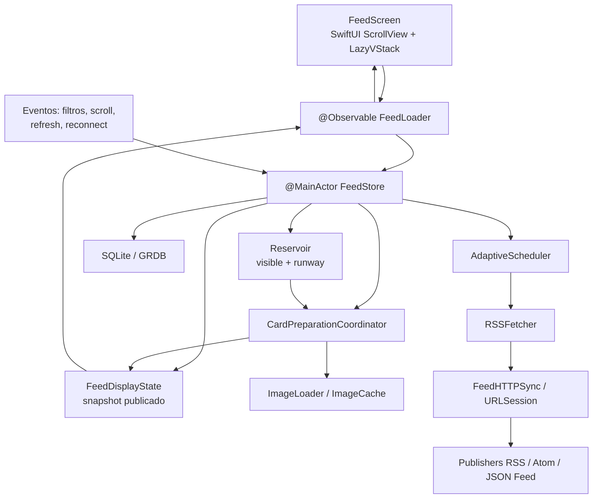
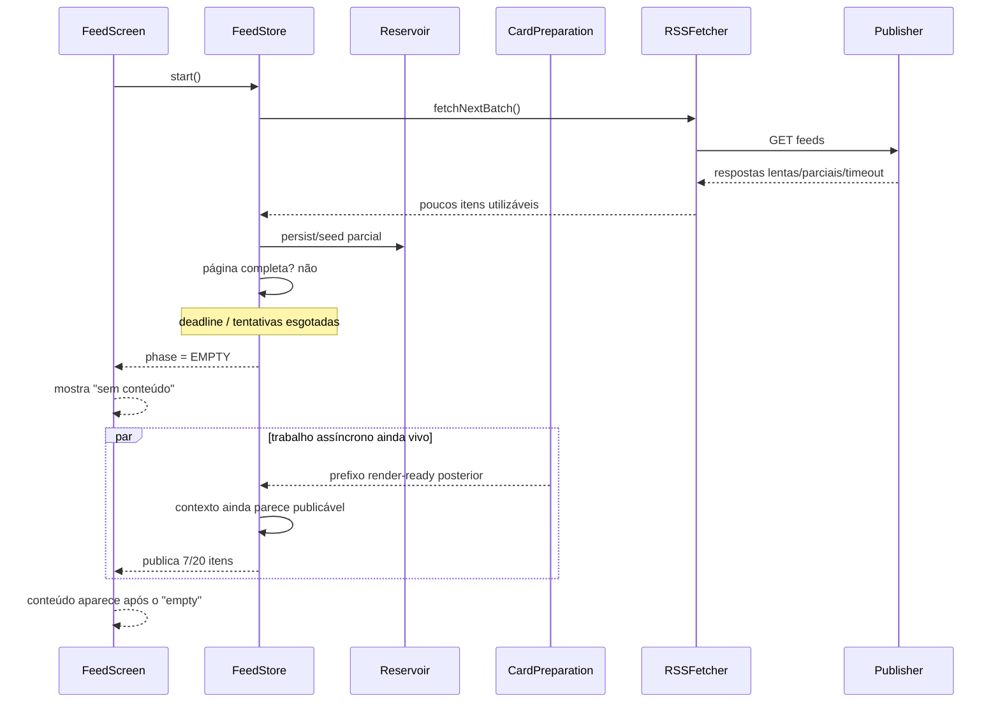

# Diagnóstico profundo da fluidez e da independência da UI do Feedmine

## Resumo executivo

A análise do `main` atual do Feedmine, no snapshot `b5c2f59` de 18 de setembro de 2026, aponta para uma conclusão importante: **os quatro sintomas relatados provavelmente não têm uma única causa**. Há pelo menos duas famílias diferentes de problemas: uma relacionada à **correção do estado publicado para a UI** e outra relacionada à **latência de renderização e trabalho concorrente durante o scroll**. O próprio registro do Build 17 informa que o trabalho P1.4 de responsividade ainda estava incompleto. fileciteturn35file0L2-L7

A causa mais forte para o sintoma *“no content → conteúdo aparece depois”* já está praticamente demonstrada no próprio código e histórico de medição. O cold start pode concluir que não existe uma página completa, mudar a superfície para `.empty` e retornar; entretanto, uma publicação assíncrona posterior ainda pode chegar. Um commit recente registra exatamente um caso em que o app declarou `cold start withheld ... empty surface`, mas **12 segundos depois publicou uma página parcial de sete itens**, e marca explicitamente esse lado do problema como ainda aberto. fileciteturn34file0L2-L7 O código atual também contém o caminho que, após o limite de tentativas, executa `setFeedDisplayPhase(.empty(...))` quando a página completa não ficou pronta. fileciteturn49file0L2-L6

Isso significa que há uma violação arquitetural central:

> **“não encontrei conteúdo suficiente ainda” está, em algumas situações, sendo transformado em “não existe conteúdo”.**

Para uma UI verdadeiramente independente do backend/rede, esses estados precisam ser semanticamente diferentes.

Ao mesmo tempo, o código atual já contém várias correções importantes para problemas antigos. O `FeedScreen` mantém uma página existente enquanto uma nova composição está em `.preparing`, distingue uma composição filtrada ainda em processamento de um resultado realmente vazio e evita deliberadamente apresentar “no results” enquanto essa composição não terminou. fileciteturn57file0L2-L6 O pipeline preparado também resolve imagens antes da publicação e a `PreparedCardImage` é deliberadamente livre de rede/trabalho assíncrono durante a renderização. fileciteturn46file0L1-L10 Portanto, eu não trataria antigos bugs de “imagem apareceu e mudou o tamanho do card” ou “qualquer refresh zera o feed” como causa primária sem primeiro demonstrar uma regressão no build atual.

Há também um detalhe fundamental sobre a palavra **backend**. O Feedmine atual é um aplicativo SwiftUI com armazenamento local, reservoir e ingestão direta de feeds; o caminho observado no código não é o clássico “frontend chama uma API paginada do Feedmine”. O `FeedStore` coordena SQLite, scheduler, reservoir, RSS fetcher e preparação dos cards, enquanto `FeedHTTPSync` conversa diretamente via `URLSession` e implementa semântica HTTP dos publishers. fileciteturn48file0L2-L6 fileciteturn25file0L1-L7 Assim, “independência do backend” deve ser entendida aqui como **a UI não depender do timing da ingestão, dos publishers remotos nem da preparação assíncrona para manter um snapshot visual válido**.

Minha priorização é:

| Hipótese de causa raiz | Sintomas explicados | Confiança atual | Impacto | Esforço provável |
|---|---|---:|---:|---:|
| Publicação tardia depois de um estado terminal `.empty` no cold start | falso “no content”, conteúdo surge depois, instabilidade | **Muito alta** | Muito alto | Médio |
| Semântica incorreta entre `empty`, `preparing`, `exhausted` e “runway insuficiente” | falso vazio, feed terminando cedo | **Alta** | Muito alto | Médio |
| Fronteira assíncrona entre `loadMore`, Reservoir, preparação dos cards e fetch | feed acaba temporariamente, pausa/stutter no fim da página | **Alta** | Alto | Médio–alto |
| Grande domínio de estado coordenado por `@MainActor FeedStore` + invalidações SwiftUI | pequenos stutters, instabilidade durante mudanças | **Média–alta** | Alto | Alto |
| Trabalho de main thread causado por atualizações de view/layout, callbacks de scroll e publicação em bursts | pequenos saltos/stutters | **Média–alta** | Alto | Médio |
| Pressão de memória/imagens em sessões longas | degradação progressiva, hitches, eventual reload | **Média** | Alto | Médio |
| Latência/jitter/timeouts/429/503 dos publishers escapando da camada de aquisição para decisões de UI | feed incompleto, “fim” temporário | **Média–alta** | Alto | Médio |
| Corridas entre geração antiga/nova em filtros, refresh, reconnect ou tarefas já disparadas | vazio transitório, conteúdo incorreto, instabilidade | **Média** | Alto | Médio |
| Problemas de identidade/virtualização/layout do `LazyVStack` | pequenos jumps | **Média** | Médio–alto | Médio |
| HTTP/2 versus HTTP/1.1 isoladamente | lentidão de alguns feeds | **Baixa** como causa principal da UI | Médio | Baixo |
| SSE/WebSocket mal implementado | — | **Muito baixa / não aplicável ao código encontrado** | — | — |

O item mais importante não é “otimizar SwiftUI” primeiro. É **tornar a publicação para a UI transacional e monotônica**: depois que a UI recebe um estado terminal para uma determinada geração, nenhum trabalho assíncrono daquela geração deve poder contradizê-lo posteriormente. Isso eliminaria uma classe inteira de falsos vazios, páginas parciais e mudanças inesperadas.

Também não usaria Lighthouse ou Chrome como ferramentas principais para este caso. O aplicativo observado é nativo SwiftUI; o equivalente correto é SwiftUI Instruments + Time Profiler + Hitches + Allocations + URLSession metrics. A Apple recomenda especificamente o SwiftUI Instrument para encontrar updates demorados de `body`, relacioná-los ao Time Profiler e entender a causa das atualizações; Xcode 26 também expõe a quantidade e duração de View Body Updates. citeturn3search0turn3search24 Chrome DevTools e WebPageTest continuam úteis para estudar **sites/publishers que o Feedmine consulta**, mas não para diagnosticar diretamente o render loop do `FeedScreen`. citeturn6search0turn6search4

**Limitações desta investigação:** o código e histórico do repositório puderam ser examinados, mas não foram fornecidos nesta conversa traces atuais de Instruments, logs de um dispositivo afetado, packet captures, MetricKit/RUM de produção nem o hardware/iOS exato onde o sintoma está sendo visto. Portanto, “muito alta” significa que há evidência direta no código/histórico; hipóteses de fluidez continuam precisando de confirmação em runtime. O nível de acesso operacional a logs de produção, os devices específicos, versões de Xcode/iOS do teste e qualquer infraestrutura externa não representada no repositório permanecem não especificados.

## Arquitetura real e pontos onde a UI ainda depende do pipeline

Os conceitos de navegador pedidos na investigação precisam ser traduzidos para a arquitetura real. Não existe Virtual DOM no SwiftUI. O equivalente funcional é o grafo de dependências de estado do SwiftUI, reavaliação de `body`, identidade das views, reconciliação da árvore, layout e entrega da composição ao sistema gráfico. SwiftUI executa atualizações da view no main actor; a recomendação atual da Apple é deixar apenas o estado que dirige a UI nesse domínio e mover trabalho computacional para fora dele. citeturn3search4turn3search12

O caminho principal encontrado é aproximadamente este:



O `FeedStore` é `@MainActor @Observable` e agrega `DatabaseQueue`, `SourceRegistry`, `AdaptiveScheduler`, `Reservoir`, `RSSFetcher`, prefetcher, card queue, display state, network monitor, stores auxiliares e componentes do prepared pipeline. fileciteturn48file0L2-L6 Isso não significa automaticamente que todo esse trabalho bloqueia a main thread — várias operações já usam actors ou detached tasks — mas significa que **o ponto de coordenação é muito amplo**. O Build 17 ter sido entregue com a decomposição P1.4 ainda incompleta reforça que essa fronteira continua sendo uma área relevante. fileciteturn35file0L3-L7

A árvore visual principal é `ScrollView` → `LazyVStack` → seções → `FeedItemView`. Cada card executa `onScrollVisibilityChange` e `onAppear`; no `onAppear`, o app atualiza o índice visível e cria uma `Task` que chama `loadMoreIfNeeded`. Há também `onScrollGeometryChange` para cada mudança de offset. fileciteturn59file0L2-L6 Isso dá ao scroll três tipos distintos de trabalho reativo:

1. materialização/desmaterialização normal do `LazyVStack`;
2. cálculo e publicação de visibilidade/seen state;
3. tentativa de paginação e monitoramento do offset.

O `loadMoreIfNeeded` já tem uma proteção de 300 ms para rejeitar chamadas sucessivas e só reage nos cinco últimos itens, portanto não é uma tempestade irrestrita. Porém ele ainda faz uma busca linear por `id`, agenda um append e, se o reservoir está abaixo de 80 itens, aguarda `fetchNextBatch()`. fileciteturn53file0L2-L6 A consequência arquitetural é que o “próximo conteúdo” atravessa:

`viewport → append → Reservoir → filtro assíncrono → preparação render-ready → publicação → talvez network fetch`.

Esse é um caminho muito mais complexo do que um simples append de 20 objetos já prontos.

O próprio Reservoir demonstra que problemas de scroll estrutural já foram encontrados antes. Hoje ele evita intencionalmente remover itens do início da lista porque isso deslocaria o offset do `ScrollView + LazyVStack`; o trim acontece na cauda e os itens removidos voltam ao início do reservoir para que o feed não morra naquele ponto. O comentário atual registra explicitamente que uma versão anterior descartava esses itens e fazia o feed “dead-end mid-session”. fileciteturn54file0L2-L6 Isso é positivo, mas também prova que **virtualização, buffer e paginação interna já foram causas reais dos sintomas relatados**.

Há ainda uma diferença importante entre *aquisição* e *publicação*. O Feedmine já tenta fazer isso corretamente: imagens são resolvidas no pipeline de preparação antes de o card entrar no feed; a view final de imagem não dispara rede nem anima opacity. fileciteturn40file0L1-L6 fileciteturn46file0L1-L10 A mesma disciplina precisa valer para **a página inteira**, não apenas para a imagem de um card.

O estado desejável é:

```text
REDE / SQLITE / PREPARAÇÃO
          │
          ▼
      staging state
          │
          │ valida geração + completude + identidade
          ▼
   snapshot imutável/atômico
          │
          ▼
      FeedScreen
```

e não:

```text
resultado parcial → items = 0 → empty
                         │
                 tarefa antiga termina
                         ▼
                 items = 7 ou 20
```

## Hipóteses de causa raiz por sintoma

**Falso “sem conteúdo”, seguido por conteúdo.** Esta é a hipótese mais bem sustentada. O cold-start atual persiste resultados parciais, exige uma página considerada completa para revelar a superfície e, se a condição não for satisfeita dentro do fluxo de tentativas, pode marcar `.empty`. fileciteturn49file0L2-L6 O histórico da correção do page cache registra que a decisão “cold start withheld” não bloqueava a publicação assíncrona que chegava depois; no experimento citado, sete itens foram publicados 12 segundos após a superfície já ter sido declarada vazia. fileciteturn34file0L3-L7

O problema não é apenas visual. É uma questão de **ownership da geração**: quem tem autorização para publicar depois que aquela geração foi declarada terminal? A resposta deveria ser “ninguém”. Atualmente existem guards de `presentationEpoch` em vários pontos, inclusive uma revalidação após `commitPublished`, o que é bom. fileciteturn51file0L2-L6 Mas o caso medido mostra que alguma operação legítima da mesma composição ainda consegue fazer uma publicação posterior à decisão de `empty`. O epoch sozinho não resolve isso: é necessário também um **lifecycle terminal da geração**.

**Feed terminando prematuramente.** Há quatro mecanismos plausíveis.

Primeiro, o feed visual pode alcançar os últimos cinco itens antes que o próximo prefixo preparado esteja publicado. `loadMoreIfNeeded` move até uma página de 20 itens do reservoir, aplica filtros de forma assíncrona e, no pipeline preparado, ainda precisa converter o resultado em cards render-ready. fileciteturn53file0L2-L6 Se o filtro remove uma grande proporção dos candidatos ou a preparação de mídia demora, a distância lógica de 20 itens não equivale a 20 novos cards disponíveis.

Segundo, `Reservoir.moveToVisible` simplesmente retorna se o reservoir estiver vazio. fileciteturn54file0L2-L6 O fetch só é disparado no caminho de scroll quando o reservoir cai abaixo do low watermark de 80. fileciteturn53file0L2-L6 Uma condição de “buffer tem itens, mas poucos sobrevivem ao filtro/preparação” pode, portanto, fazer o runway real da UI ser muito menor que o runway bruto medido pelo reservoir.

Terceiro, publishers podem produzir resultados `.notModified`, `.modifiedWithoutNewItems`, `.failed` ou `.throttled`. O `RSSFetcher` contabiliza separadamente todas essas categorias. fileciteturn24file0L1-L2 Uma sequência de feeds lentos, vazios ou throttled pode deixar o scheduler sem novos itens utilizáveis, embora o sistema ainda não possa afirmar semanticamente que o feed global acabou.

Quarto, o histórico recente contém um defeito de page-cache no qual a primeira publicação parcial de uma sessão — dois itens no caso medido — ficava persistida para o próximo warm start porque publicações append não atualizavam o cache. Isso foi corrigido para persistir a primeira página real, incluindo appends, e limitar o cache a uma página. fileciteturn34file0L3-L7 Não trataria essa implementação específica como bug atual, mas criaria um teste de regressão obrigatório porque ela produz exatamente “feed curto no reopen”.

**Pequenos jumps.** O primeiro suspeito seria alteração da geometria de cards já publicados; o pipeline atual foi explicitamente desenhado para evitá-la, resolvendo a imagem antes de publicar a apresentação. fileciteturn40file0L2-L6 Isso reduz bastante a probabilidade dessa causa no feed principal atual.

Restam três candidatos mais fortes:

- mutação da estrutura da sequência — inclusão/remoção/reordenação de itens acima ou perto do viewport;
- alteração de padding/header durante scroll;
- hitch no main thread percebido como pequeno “pulo”, mesmo sem mudança real de offset.

O próprio Reservoir contém uma regra rígida para nunca remover itens do início porque isso deslocaria o scroll. fileciteturn54file0L2-L6 Portanto, todo lugar fora do Reservoir que faça um replace completo da sequência deve ser auditado com o mesmo critério. `applyUpdate(.flush)` ainda zera `visibleItems` e o reservoir antes de recarregar, embora os caminhos de UI tentem esconder essa transição corretamente. fileciteturn52file0L2-L6 Uma regressão no display-phase ou um replace durante uma composição já visível pode produzir movimento estrutural.

Além disso, o `FeedScreen` mantém header dinâmico, FilterLens, busca, mini player, materiais translúcidos e manipulação do offset. fileciteturn57file0L2-L6 fileciteturn59file0L2-L6 Esses componentes precisam ser separados no trace entre:

```text
mudança real de contentOffset
vs.
frame perdido enquanto o dedo continua movendo
vs.
mudança de altura acima do primeiro card visível
```

São três bugs diferentes que visualmente parecem “jump”.

**Stutters.** SwiftUI faz avaliação de UI no main actor, e a Apple recomenda usar o SwiftUI Instrument para localizar View Body Updates excessivos/demorados e correlacioná-los com Time Profiler. citeturn3search0turn3search4 O fato de `FeedStore` ser um objeto `@MainActor @Observable` grande torna especialmente importante confirmar se mutações relacionadas a rede, counters, loading state, read state e card generation estão invalidando mais views do que deveriam. fileciteturn48file0L2-L6

O código já contém otimizações nessa direção: `FeedScreen` usa lookup de cards por seção com cache “para evitar O(n) rebuilds durante scroll-driven body evaluations”. fileciteturn59file0L2-L6 Esse comentário é revelador: custo de reconstrução durante scroll é uma área que já precisou de intervenção.

**Imagens e recursos.** A arquitetura atual é muito melhor que uma `AsyncImage` ingênua: `ImageLoader` faz memory cache → disk cache → espera por download em andamento → rede → fallback OpenGraph, com deduplicação de downloads. fileciteturn40file0L2-L6 A imagem é downsampled para no máximo 800 px e o cache de memória é configurado com `countLimit = 200` e `totalCostLimit = 200 MB`; o disk cache é limitado a 100 MB. fileciteturn44file0L2-L6

Isso transfere o risco de “layout shift causado por download” para outro risco: **pressão de memória em sessões longas**. Duzentos megabytes é um teto significativo apenas para o NSCache de imagens, além de cards, feed items, SQLite pages, UIKit/CoreAnimation backing stores e demais objetos. O impacto real depende do device e deve ser medido, não inferido apenas do limite. A Apple recomenda Allocations e Memory Graph para distinguir crescimento transitório, persistente e leaks. citeturn4search1turn4search4

Swift não usa um garbage collector clássico para esses objetos; ARC é o mecanismo principal de gestão de referências, embora retain cycles, autorelease pools, bursts de desalocação e pressão de heap continuem podendo causar problemas. A Apple destaca retain cycles como causa comum de leaks em Swift e recomenda Memory Graph/Allocations para encontrá-los. citeturn4search6 Portanto a dimensão “GC” deve ser testada como **ARC/deallocation/autorelease/memory pressure**, não como pausas de um tracing GC de JVM/V8.

**Rede e protocolo.** O transport atual é relativamente defensivo. `RSSFetcher` usa 15 s de request timeout e 30 s de resource timeout no caminho normal; o starter usa limites menores de 5 s/7 s; há URLCache e limites de conexões por host. fileciteturn24file0L1-L2 `FeedHTTPSync` implementa `ETag`, `If-None-Match`, `Last-Modified`, 304, leitura de `Cache-Control`/`Expires`, redirect canonicalization e tratamento específico de 429/503 usando `Retry-After`, com fallback de 60 s e clamp de até 24 h. fileciteturn25file0L2-L7

Isso significa que os cabeçalhos de cache e 429/503 já são tratados, mas devem entrar na telemetria de completude. Uma explosão de 429/503 não deveria produzir “acabou o feed”; deveria produzir algo equivalente a **“sem runway novo neste momento”**. Esses significados precisam permanecer separados.

HTTP/2 também não deve ser presumido. `URLSessionTaskTransactionMetrics.networkProtocolName` informa o protocolo realmente usado em cada transação e é a forma correta de medir HTTP/1.1 versus h2/h3 no cliente. citeturn3search1turn3search5 Antes de otimizar protocolos, eu verificaria se TTFB, DNS, TLS ou throttling realmente correlacionam com o problema.

Não encontrei no caminho atual examinado evidência de SSE ou WebSocket como mecanismo do feed; o transporte observado é `URLSession` com requisições HTTP de RSS/Atom/JSON Feed. Assim, SSE/WebSocket devem permanecer no plano apenas caso exista uma infraestrutura não representada pelo repositório analisado. fileciteturn25file0L2-L7

A reconciliação “backend pagination × frontend cursor” também não é uma paginação REST convencional. O cursor efetivo é composto por **posição visível + Reservoir + estado do scheduler + composição/filtro + geração + pipeline preparado**. Essa é precisamente uma razão para formalizá-lo: no estado atual, “has more” está implícito em várias estruturas em vez de ser uma propriedade única e auditável.

Uma matriz completa das dimensões pedidas fica assim:

| Dimensão | Mecanismo que pode falhar | Evidência/risco no Feedmine | Relação com sintomas |
|---|---|---|---|
| Reconciliation SwiftUI | updates de `body` excessivos, identidade instável | `@Observable` amplo + feed complexo | stutter |
| Layout | altura/header/card muda após publicação | mitigado para imagens; demais overlays permanecem | jump |
| Compositing | materiais, imagens e layers pressionam frame budget | precisa de Core Animation/Hitches trace | stutter |
| State management | estado intermediário é observado como terminal | caso cold-start confirmado | falso vazio |
| Subscriptions | mutação global invalida views demais | precisa SwiftUI cause/effect trace | stutter |
| Batching | vários publishes pequenos em vez de snapshot único | partial page já foi medido | instabilidade |
| Fetch strategy | runway visual depende de fetch/preparation | presente | fim temporário |
| Caching | cache parcial/stale | bug recente corrigido; regressão crítica | feed curto |
| Pagination | `visibleItems`/Reservoir/prepared prefix desalinhados | arquitetura atual | fim precoce |
| Streaming | corpo HTTP só vira feed útil após parse | dados são acumulados antes do parse | latência de conteúdo |
| Optimistic update | pouco relevante para novos artigos | melhor para read/bookmark, não para ingestão | secundário |
| Latência/jitter | publishers heterogêneos | esperado e explicitamente bounded | completude |
| Retries | imagem e HTTP têm políticas diferentes | presente | latência/bursts |
| Timeout | starter e normal usam limites distintos | presente | página insuficiente |
| HTTP/2 | negociação variável por publisher | deve ser medido via task metrics | secundário |
| WebSocket/SSE | não observado | aparentemente N/A | N/A |
| Main thread | SwiftUI + coordenação de estado | risco relevante | stutter |
| Workers | equivalente são actors/detached tasks | vários já existem | mitigação parcial |
| Request coalescing | imagens coalescidas; load-more parcialmente debounced | incompleto no nível da página | bursts |
| Imagens | decode/cache/network | pipeline preparado forte | memória/CPU |
| Fonts | sem evidência de fonte remota crítica | testar apenas se custom fonts existirem | baixo |
| Large assets | catálogo/cache/imagens | relevante | memória/startup |
| Lazy loading | `LazyVStack` | presente | bom, mas não suficiente |
| ARC/leaks | objetos/tarefas/caches retidos | precisa Memory Graph | degradação longa |
| Virtual scrolling | trim/append precisam preservar posição | bugs históricos já existiram | jump/dead-end |
| Cursor/state | cursor é distribuído em várias estruturas | alto risco sem modelo explícito | fim precoce |
| Fallback UI | `.empty` pode competir com trabalho tardio | causa atual forte | falso vazio |
| Race conditions | epochs existem mas terminal-state lease não | risco confirmado no cold start | instabilidade |
| Debounce/throttle | load more 300 ms, trim 1,5 s | presente | pode mascarar ou atrasar |
| Logging | muitos logs/signposts locais, pouca evidência de RUM agregado | lacuna | diagnóstico difícil |

## Testes reproduzíveis e profiling

A primeira tarefa é separar **hitch de renderização**, **mudança de geometria**, **espera por dados** e **estado incorreto**. Sem essa separação, todos parecem “feed instável”.

A sequência típica do falso vazio que eu tentaria reproduzir é:



Essa timeline é consistente com a situação explicitamente registrada no histórico recente: `cold start withheld` seguido de publicação posterior. fileciteturn34file0L3-L7

Os testes de maior valor seriam:

| Teste | Procedimento | Invariante esperada | Diagnóstico se falhar |
|---|---|---|---|
| Cold start vazio → tardio | limpar container/cache, aplicar 200–500 ms RTT + jitter, abrir app 30 vezes | nunca observar `.empty` seguido por `items > 0` na mesma geração | lifecycle de geração quebrado |
| Cold start offline | iniciar totalmente offline e reconectar após 5/15/30 s | estado offline/preparing não pode mentir como ausência definitiva | fallback UI |
| Scroll rápido | reservoir previamente cheio, scroll contínuo até >300 cards | offset não deve retroceder; nenhum gap terminal enquanto `hasMore=true` | virtualização/runway |
| Reservoir baixo | começar com 20–40 itens e rede lenta | loading-more antecipado antes dos últimos cards | watermark tarde demais |
| Filtro A→B→A | trocar filtros em <1 s sob rede lenta | nenhuma publicação de epoch anterior | race |
| Pull-to-refresh durante scroll | refresh no meio do viewport | cards lidos não se movem | replace indevido |
| Reconnect | Wi-Fi off/on repetidamente | no refresh concorrente duplicado; estado estável | race/retry |
| 429/503 | publishers mock retornam Retry-After | feed preservado; não virar “acabou” | backend acoplado à UI |
| 304/cache | alternar 200/304 com ETag | nenhum empty/cache reset | cache semantics |
| Truncation | cortar XML a 25/50/90% | erro de fonte isolado, página anterior preservada | partial response |
| Reorder | mesma lista RSS em ordem diferente a cada fetch | itens já publicados não mudam de posição | ordering |
| Image stress | 100 cards com imagens grandes e cache frio | geometria não muda; sem long main-thread decode | resource pipeline |
| Long session | scroll 1.000+ cards | footprint estabiliza ou cresce dentro de envelope definido | memory retention |
| Background/foreground | repetir 30 ciclos | sem multiplicação de Tasks/fetches | task leak |

Para fluidez, o profiler principal deve ser o SwiftUI Instrument combinado com Time Profiler e Hitches. A Apple define hitches como atrasos perceptíveis durante interações contínuas como scroll e animações e fornece tooling específico para isso. citeturn8search3turn3search0

Exemplo de captura via linha de comando; os nomes de device/app devem ser substituídos pelos do ambiente:

```bash
# Descobrir devices e templates instalados
xcrun xctrace list devices
xcrun xctrace list templates

# Exemplo de Time Profiler em device físico
xcrun xctrace record \
  --template "Time Profiler" \
  --device "<DEVICE-UDID>" \
  --time-limit 45s \
  --output Feedmine-TimeProfiler.trace \
  --launch -- "<PATH-TO-Feedmine.app>"
```

Eu faria capturas separadas para:

```text
A. scroll puro, cache quente e rede bloqueada
B. scroll puro, cache frio
C. scroll + loadMore
D. troca de filtro
E. cold start
F. cold start sob jitter
```

Se A tem hitch, a rede não é a causa. Se apenas C tem hitch, investigar publicação/pipeline/fetch. Se B é pior que A, imagens/cache/IO. Se D gera longa sequência de View Body Updates, state fan-out/reconciliation.

O Feedmine já possui infraestrutura de signposts. `FeedMineSignposts` define intervalos para startup, catálogo, parsing, timeline, first card render, imagens, persistence e background refresh; `FeedMetrics` também consegue registrar footprint físico. fileciteturn56file0L2-L6 fileciteturn28file0L2-L10 O problema é que isso ainda precisa ser conectado à **causalidade do incidente**, não apenas ao tempo de funções.

Eu adicionaria um `traceID` por sessão e um `compositionGeneration` em toda linha relevante:

```text
session=9A12
generation=144
phase=preparing
visible=20
prepared=31
reservoir=184
inflight_fetches=5
publish_seq=7
reason=scroll_append
```

e todo publish deveria gerar algo equivalente a:

```text
feed.publish
  generation=144
  publish_seq=7
  operation=append
  visible_before=20
  visible_after=40
  first_id=...
  last_id=...
  viewport_anchor_id=...
  reservoir_before=184
  reservoir_after=164
  terminal=false
```

Quando a geração termina:

```text
feed.generation.terminal
  generation=144
  phase=ready|empty|failed
  terminal_seq=8
```

Qualquer `feed.publish generation=144` depois disso é automaticamente um bug de severidade alta.

Para rede, o `URLSessionTaskMetrics` deveria registrar por request DNS, connect, TLS, TTFB, duração total, bytes, reutilização da conexão e `networkProtocolName`. A Foundation fornece essas métricas diretamente por transação. citeturn3search5turn3search9

Para testar publishers manualmente:

```bash
URL='https://publisher.example/feed.xml'

curl -sv \
  --http2 \
  --connect-timeout 5 \
  --max-time 20 \
  --compressed \
  -D /tmp/feed-headers.txt \
  -o /tmp/feed.xml \
  "$URL"
```

Para capturar timings repetidamente:

```bash
for i in $(seq 1 30); do
  curl -sS -o /dev/null \
    -w 'run=%{num_connects} code=%{http_code} dns=%{time_namelookup} connect=%{time_connect} tls=%{time_appconnect} ttfb=%{time_starttransfer} total=%{time_total} bytes=%{size_download}\n' \
    "$URL"
done
```

Para verificar conditional GET:

```bash
curl -sS -D /tmp/h1 -o /tmp/feed1 "$URL"

ETAG=$(awk 'BEGIN{IGNORECASE=1} /^etag:/ {
  sub(/\r$/, "", $0); sub(/^[^:]*:[[:space:]]*/, "", $0); print; exit
}' /tmp/h1)

curl -sv \
  -H "If-None-Match: $ETAG" \
  -D /tmp/h2 \
  -o /dev/null \
  "$URL"
```

O curl suporta seleção explícita de HTTP/2/HTTP/3 para diagnóstico, embora isso não substitua medir o protocolo realmente negociado pelo `URLSession` do app. citeturn6search2

Para injetar latência/jitter/perda em um proxy Linux ou ambiente de teste:

```bash
# Exemplo: 180 ms ± 60 ms, 1% packet loss
sudo tc qdisc add dev eth0 root netem \
  delay 180ms 60ms distribution normal \
  loss 1%

# Inspecionar
tc qdisc show dev eth0

# Remover
sudo tc qdisc del dev eth0 root
```

`netem` oferece justamente parâmetros de latency, jitter, loss, duplication e reorder, tornando-o adequado para esta matriz de falhas. citeturn6search3turn6search6

Eu testaria pelo menos estes perfis:

| Perfil | RTT/jitter | Loss | Propósito |
|---|---:|---:|---|
| Baseline | ~0 artificial | 0 | controle |
| Wi‑Fi razoável | 40 ± 10 ms | 0 | cotidiano |
| Mobile bom | 100 ± 30 ms | 0,2% | variação |
| Mobile ruim | 250 ± 100 ms | 1% | race/deadline |
| Intermitente | 300 ± 200 ms | 3% | retries |
| Blackhole | timeout | 100% | fallback/independência |

Chrome DevTools e WebPageTest devem ser usados apenas para os **publishers/pages HTML** — por exemplo, se o pipeline cai no fallback OpenGraph. Chrome permite gravar atividade de runtime e visualizar main-thread/rendering/network no Performance panel. citeturn6search0turn6search11

Uma captura de Chrome útil seria:

```text
1. Abrir a URL do artigo/feed no Chrome
2. DevTools → Performance
3. Record
4. Reload
5. Parar após o conteúdo/imagem estabilizar
6. Exportar o trace JSON
```

Para automação pelo WebPageTest, em instalações que ainda exponham a API clássica:

```bash
export WPT_API_KEY='<key>'
export TEST_URL='https://publisher.example/article'

curl -G 'https://www.webpagetest.org/runtest.php' \
  --data-urlencode "url=$TEST_URL" \
  --data-urlencode "k=$WPT_API_KEY" \
  --data-urlencode 'f=json' \
  --data-urlencode 'runs=3'
```

O valor aqui não é medir o `LazyVStack`; é descobrir publishers cujo HTML demora, redireciona excessivamente, entrega imagem hero muito tarde ou tem TTFB anormal, porque o `ImageLoader` pode recorrer ao HTML do artigo quando o feed não oferece uma imagem adequada. Esse fallback existe explicitamente no pipeline atual. fileciteturn40file0L2-L6

Para memória, usar Allocations + VM Tracker + Memory Graph em três snapshots: início, após 300 cards e após 1.000 cards. A Apple recomenda analisar separadamente crescimento transitório, persistente e leaks em vez de inferir um leak apenas porque o footprint subiu. citeturn4search1turn4search4

## Correções recomendadas e arquitetura de independência

A correção prioritária deveria ser conceitual: **a UI só consome snapshots publicados, e a rede nunca publica diretamente sem passar por um commit transacional da composição**.

Eu introduziria explicitamente um objeto semelhante a:

```swift
struct FeedSnapshot: Sendable {
    enum Phase: Sendable {
        case preparing
        case ready
        case emptyConfirmed
        case failed
    }

    let generation: UInt64
    let publication: UInt64
    let phase: Phase
    let items: [FeedItem]
    let hasMore: Bool
    let acquisitionInFlight: Bool
}
```

O ponto central não é essa estrutura específica, mas suas invariantes:

```text
generation N:
preparing → ready
preparing → emptyConfirmed
preparing → failed

ready → ready          permitido: append estável
emptyConfirmed → *     proibido para N
failed → *             proibido para N

nova informação depois de terminal:
criar generation N+1
```

Isso resolveria a anomalia existente em que uma geração pode declarar “empty surface” e depois receber publicação tardia. O problema já foi observado no próprio histórico do projeto. fileciteturn34file0L3-L7

**O `empty` precisa ser uma afirmação provada, não a ausência temporária de itens.** Eu substituiria qualquer lógica conceitual equivalente a:

```swift
if items.isEmpty {
    phase = .empty
}
```

por:

```swift
guard generationIsClosed else {
    phase = .preparing
    return
}

phase = candidatesExhausted && pendingFetches == 0
    ? .emptyConfirmed
    : .preparing
```

O FeedScreen já caminha nessa direção ao mostrar `.fetching` quando `isPreparingFilteredComposition` e `items.isEmpty`. fileciteturn57file0L2-L6 O passo seguinte é fazer a garantia existir **no modelo**, e não depender de várias condições corretivas na view.

Para o cold start especificamente, a decisão terminal deveria realizar uma destas duas estratégias:

```text
Estratégia A — cancel-and-close
1. generation N entra em terminal
2. cancela pipelineTask/cardPreparationTask/fetch publishers de N
3. marca token/lease de N como closed
4. todos os commits posteriores falham

Estratégia B — don't-close-yet
1. deadline de primeiro paint expira
2. UI fica preparing/offline/degraded
3. pipeline continua
4. somente quando todo trabalho relevante termina:
   ready ou emptyConfirmed
```

O que não pode existir é o híbrido atual: **mostrar uma resposta terminal enquanto trabalhos autorizados ainda podem alterar essa resposta**.

Para paginação, eu eliminaria o conceito implícito de “tem mais” distribuído por `visibleItems`, `Reservoir.reservoirCount`, scheduler e preparation queue. Criaria um estado único:

```swift
struct FeedRunwayState {
    let generation: UInt64
    let publishedCount: Int
    let renderReadyAhead: Int
    let rawReservoirAhead: Int
    let fetchesInFlight: Int
    let sourcesEligible: Int
    let exhausted: Bool
    let exhaustedReason: ExhaustedReason?
}
```

A métrica decisiva para scroll deve ser **`renderReadyAhead`**, não apenas `reservoirCount`. Se há 100 objetos no reservoir mas 95 não sobrevivem ao filtro ou ainda dependem de preparação, o usuário efetivamente tem cinco itens de runway.

Eu também substituiria o padrão “cada card faz `Task { loadMoreIfNeeded }`” por um **único controlador coalescido de viewport**. O debounce de 300 ms existente já mostra consciência do problema. fileciteturn53file0L2-L6 Uma evolução seria:

```swift
@MainActor
final class FeedPaginationController {
    private var pendingTask: Task<Void, Never>?

    func viewportChanged(
        lastVisibleIndex: Int,
        publishedCount: Int
    ) {
        guard publishedCount - lastVisibleIndex <= 8 else { return }
        guard pendingTask == nil else { return }

        pendingTask = Task {
            defer { pendingTask = nil }
            await requestNextRenderReadyPage()
        }
    }
}
```

Com isso, `LazyVStack` deixa de ser o mecanismo de scheduling do backend. Ele apenas reporta viewport.

O `FeedStore` deveria continuar sendo main-actor para **commit de estado de UI**, mas não para ser o domínio conceitual de todas as operações. A direção recomendada seria:

```text
@MainActor
FeedDisplayModel
    snapshot
    selection
    user-visible flags

actor FeedRepository
    SQLite queries
    persistence

actor FeedAcquisition
    scheduling
    HTTP
    retry/backoff

actor FeedComposition
    filtering
    ordering
    deduplication

actor CardPreparation
    image/metadata preparation
```

O SwiftUI Group Lab da Apple reforça esse modelo: estado consumido pela view pode permanecer main-actor-aligned, enquanto computação deve ser conscientemente isolada fora dele. citeturn3search4

No pipeline de imagem, eu **manteria** a abordagem atual de render-ready cards. Ela é arquiteturalmente correta. fileciteturn46file0L1-L10 Entretanto, revisaria o envelope de 200 MB do NSCache com medições em devices reais. fileciteturn44file0L2-L6 O valor ideal deveria ser obtido empiricamente por classe de device ou reagir a memory pressure; não é necessário conservar 100 imagens em RAM se o feed continua fluido com muito menos.

No ordering, a regra deveria ser:

```text
publisher order/date
        ↓
normalização
        ↓
local stable sort key
        ↓
publication sequence imutável
```

Uma vez que um card está acima ou perto do viewport, chegada de novos itens não deveria deslocá-lo. O Reservoir já segue esse princípio ao anexar novos conteúdos sem reintercalar toda a fila e ao não remover a cabeça da lista. fileciteturn54file0L2-L6 Essa invariável deve se aplicar também a rebuilds de filtro, refresh e prepared-card publications.

Para 429/503 e falhas de publisher, o transport atual já fornece uma boa base com `Retry-After`. fileciteturn25file0L2-L7 Eu adicionaria explicitamente uma camada de semântica:

```text
source temporarily unavailable
≠
source exhausted
≠
composition empty
```

O mesmo vale para parse failure, timeout e partial response.

A matriz de implementação que eu usaria é:

| Mudança | Benefício | Impacto nos sintomas | Esforço |
|---|---|---|---|
| Terminal publication lease por geração | elimina publish após `.empty/.failed` | falso vazio, instabilidade | **Médio** |
| `emptyConfirmed` distinto de `empty-looking` | semântica correta | falso alerta | **Baixo–médio** |
| Snapshot atômico único para a UI | reduz estados impossíveis | todos | **Médio–alto** |
| `renderReadyAhead` como runway real | evita dead-end visual | fim prematuro | **Médio** |
| PaginationController coalescido | menos Tasks/callbacks por scroll | stutter | **Médio** |
| Split do FeedStore | reduz main-actor coupling | stutter/latência | **Alto** |
| Ordem visual imutável perto do viewport | elimina jumps | jump | **Médio** |
| Adaptive image memory budget | menor memory pressure | sessões longas | **Médio** |
| URLSessionTaskMetrics por request | encontra causas de rede | completude | **Baixo** |
| MetricKit/RUM de produção | detecta regressões reais | diagnóstico | **Médio** |
| Testes de geração/terminal state | impede regressão | falso vazio | **Baixo** |
| Fault injection HTTP em CI | garante independência | todos de rede | **Médio** |

Eu priorizaria os três primeiros antes de micro-otimizações de SwiftUI.

## Métricas, logs e alertas necessários

O Feedmine já possui `OSSignposter`, mas a observabilidade necessária aqui é **cross-layer**. `FeedMineSignposts` oferece intervalos úteis, enquanto `FeedMetrics` tem parte da instrumentação condicionada a `DEBUG || INSTRUMENTATION`. fileciteturn56file0L2-L6 fileciteturn28file0L2-L10 Para saber o que usuários reais experimentam, eu adicionaria agregação de produção por MetricKit/Xcode Organizer ou RUM equivalente. A Apple disponibiliza hang diagnostics e métricas de responsividade para builds distribuídos. citeturn3search6turn3search14turn3search22

As métricas mínimas seriam:

| Camada | Métrica |
|---|---|
| UI | hitch rate, frame duration, scroll offset discontinuity |
| SwiftUI | body update count/duration por view |
| Main actor | tempo ocupado, longest uninterrupted work |
| Feed | generation, publication sequence, phase transitions |
| Feed | visible count, render-ready-ahead, reservoir-ahead |
| Feed | first useful content, first complete page |
| Feed | empty → content transitions |
| Pagination | trigger index, request latency, appended count |
| Composition | raw items → filtered → deduped → prepared |
| Network | DNS/TCP/TLS/TTFB/download/total |
| Network | HTTP protocol, status, retry count, timeout |
| HTTP | ETag/304 hit rate, cache-control, Retry-After |
| Sources | success/empty/304/throttled/failed |
| Images | memory hit, disk hit, network miss, decode duration |
| Memory | physical footprint, heap, image-cache cost |
| Tasks | active acquisition/preparation tasks por generation |
| Persistence | query/write duration, rows read/written |

As três métricas mais valiosas para os sintomas atuais seriam:

```text
false_empty_count =
  count(generation where EMPTY terminal
        followed by publication with visible > 0)

viewport_jump_points =
  abs(actualContentOffsetDelta - finger/expectedScrollDelta)
  around feed publication events

runway_starvation_ms =
  duration(renderReadyAhead == 0
           && !exhausted
           && user_near_end)
```

**`false_empty_count` deveria ter SLO zero.** Não é uma métrica probabilística de performance; é uma violação lógica.

Eu registraria também um histograma:

```text
raw reservoir ahead
vs.
render-ready ahead
```

Se os incidentes de feed ending ocorrerem com:

```text
reservoirAhead = 120
renderReadyAhead = 0
```

o culpado é preparação/composição.

Se ocorrerem com:

```text
reservoirAhead = 0
eligibleSources > 0
fetchesInFlight = 0
```

o scheduler/pagination falhou.

Se:

```text
reservoirAhead = 0
eligibleSources = 0
throttledSources = 72
```

é uma situação de aquisição, não um bug de virtualização.

Se:

```text
visible = 40
renderReadyAhead = 40
mas UI parou no item 39
```

é problema de SwiftUI/identidade/publicação.

Nos logs de phase transition eu exigiria:

```text
old_phase
new_phase
generation
reason
visible_count
prepared_count
reservoir_count
pending_fetch_count
network_state
elapsed_since_generation_start
```

e criaria alertas iniciais como:

| Alerta | Condição |
|---|---|
| False Empty | qualquer `empty terminal → content` na mesma geração |
| Starved Feed | `renderReadyAhead=0`, `exhausted=false` por >2 s perto do fim |
| Stale Publish | publish com `generation != activeGeneration` |
| Terminal Publish | publish após generation closed |
| Network Storm | requests simultâneos acima do limite esperado |
| Source Throttle Burst | crescimento abrupto de 429/503 |
| Main-thread Hitch | aumento significativo de hangs/hitches por versão |
| Memory Growth | footprint cresce monotonicamente após scroll equivalente |
| Partial Cache | warm page menor que a página final da sessão anterior |
| Ordering Mutation | IDs anteriores ao anchor mudam sem ação explícita do usuário |

Os valores de performance — p95, p99 e limites de memória — devem ser derivados do baseline em devices reais, não escolhidos arbitrariamente. Já a correção lógica de stale/terminal publication pode e deve ser binária.

## Plano de validação e ordem recomendada

Eu faria a investigação em quatro passes, sempre no mesmo build e nos mesmos devices físicos antes de comparar resultados. Simulator é útil para determinismo, mas não substitui medição de hitches, GPU e memory pressure no hardware real. A própria infraestrutura de performance do projeto já diferencia testes informativos de simulator e medições em device para hitch/scroll. fileciteturn27file9L135-L143

**Primeiro, provar a correção do modelo de estado.** Instrumentar `generation`, terminal state e publication sequence; executar 100 cold starts sob baseline, 100 com 250 ms de latência/jitter, 100 com perda e 100 offline→online. A aceitação é absoluta:

```text
emptyTerminalThenContent == 0
staleGenerationPublish == 0
terminalGenerationPublish == 0
```

O caso medido existente de `cold start withheld → 7 items 12 s depois` deve virar um teste automatizado que falha antes da correção e passa depois. fileciteturn34file0L3-L7

**Depois, provar que o feed não pode terminar enquanto existe conteúdo potencial.** Executar scroll rápido e lento contra fixtures determinísticas com 20, 21, 40, 100, 300 e 1.000 itens; repetir com 10%, 50% e 90% dos candidatos removidos pelos filtros. Em cada momento registrar:

```text
lastVisibleIndex
publishedCount
renderReadyAhead
rawReservoirAhead
fetchesInFlight
eligibleSources
exhausted
```

A invariante é:

```text
usuário chegou ao último card
AND exhausted == false
=> existe loader/runway visível OU próximo card é publicado sem dead-end
```

O Reservoir já foi alterado especificamente para evitar um dead-end causado por trim, portanto esse teste deve ser permanente. fileciteturn54file0L2-L6

**Em seguida, atacar a fluidez independentemente da rede.** Rodar o feed com dataset local fixo e rede completamente bloqueada. Se ainda houver stutters, eliminar backend/network da árvore causal. Capturar SwiftUI Instrument, Hitches, Time Profiler e Allocations. A Apple recomenda começar pelos Long View Body Updates e navegar até o Time Profiler para localizar o trabalho CPU responsável. citeturn3search0

A sequência de isolamento seria:

```text
cache quente + sem rede
        ↓
cache frio + sem rede
        ↓
cache quente + rede
        ↓
cache frio + rede
        ↓
filtro/refresh + rede
```

Interpretação:

| Resultado | Causa provável |
|---|---|
| ruim em todos | render/state/main actor |
| só cache frio | IO/decode/imagem |
| só com rede | publish bursts/network coupling |
| só próximo ao fim | pagination/runway |
| só após long scroll | memory/retention/virtualization |
| só filter/refresh | generation/recomposition |
| offset muda sem hitch | layout/order mutation |
| offset contínuo mas animação trava | main-thread/GPU hitch |

Por último, executar **fault injection de backend/publishers**. Os casos obrigatórios seriam:

```text
200 lento
200 com body muito lento
200 truncado
304
301→200
429 sem Retry-After
429 com Retry-After
503 sem Retry-After
503 com Retry-After
DNS failure
TLS failure
connection reset
timeout antes de headers
timeout durante body
XML válido sem itens
XML inválido
feed reordenado
IDs duplicados
datas iguais
datas fora de ordem
```

A camada HTTP atual já distingue 304, 429 e 503 e extrai validators/cache headers. fileciteturn25file0L2-L7 O objetivo desse passe é garantir que **nenhuma dessas condições remotas consiga invalidar um snapshot visual já válido**.

O critério arquitetural final que eu usaria para declarar o problema resolvido é simples:

```text
A UI do Feedmine sempre exibe o último snapshot confirmado.

Rede, SQLite, filtros, imagens e preparação trabalham para produzir
o próximo snapshot.

Nenhum desses componentes pode desmontar o snapshot atual enquanto
o próximo ainda não está pronto.

"Empty" significa que a ausência foi confirmada.
"Loading" significa que ainda não sabemos.
"Offline/throttled/failed source" significa que não conseguimos saber agora.

E depois que uma geração termina, ela nunca mais publica.
```

O código atual já implementa partes importantes dessa filosofia — preserva a página durante `.preparing`, evita “no results” durante composição filtrada, prepara mídia antes de exibi-la e protege vários awaits com epoch checks. fileciteturn57file0L2-L6 fileciteturn51file0L2-L6 O problema restante é tornar essa filosofia **uma propriedade estrutural do pipeline inteiro**, especialmente no cold start, paginação/runway e lifecycle das tarefas assíncronas. O fato de o Build 17 ter sido explicitamente entregue com P1.4 incompleto e com a publicação parcial pós-`cold start withheld` ainda aberta torna esses pontos, e não uma otimização genérica de SwiftUI, o lugar mais provável para encontrar as causas restantes. fileciteturn35file0L3-L7