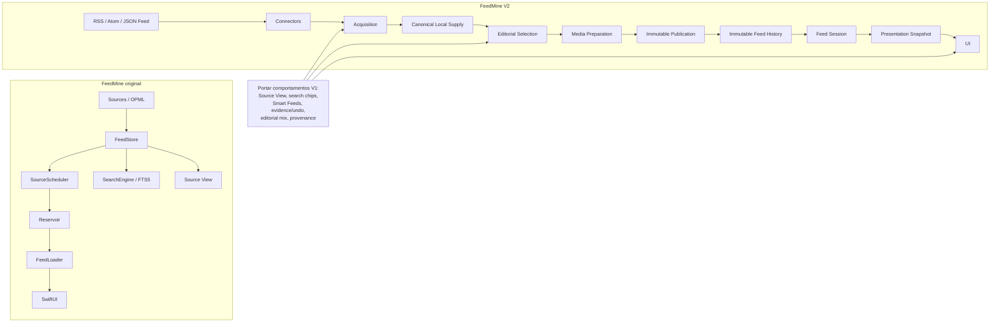

# FeedMine original vs FeedMine V2: auditoria de lacunas, regressões e soluções superiores da V1

## Escopo e método

Esta comparação usa como **FeedMine original/V1** o estado mais recente verificável do repositório `wsmontes/feedmine-dev`, cujo `main` está em `b5c2f59c55babb672c81dd978d201f98c5909934`, de 18 de setembro de 2026. Esse commit documenta o TestFlight **1.0 (17)**, cujo binário correspondia ao commit `4df951c4`, enviado em 17 de setembro. A própria nota de entrega reconhecia pendências: P1.4 incompleto e um problema de tap ainda não classificado. fileciteturn27file0

Para a **V2**, uso o `main` atual encontrado durante a pesquisa, `2aea998c20bb794facdb7e89ffb4eb7a9d1f28ec`, de 14 de outubro de 2026, mais o último binário instalável documentado, TestFlight **1.0 (32)** no commit `c6de80b7decca9a81a4888333521b696f84cf761`. A build 32 está `VALID / IN_BETA_TESTING`, mas **não é uma release de produção certificada**: B01 não obteve veredito aceito e B02–B06 não foram concluídos para o estado atual. fileciteturn28file0 fileciteturn14file0

Portanto, “latest stable” precisa de uma ressalva: não existe aqui uma V2 que possa ser honestamente chamada de “stable production release”. O comparativo é **V1 final conhecida / build 17 vs V2 HEAD + build 32 mais recente disponível**. Isso é importante porque alguns resultados abaixo são “ausente”, enquanto outros são “implementação parcial ou sem prova end-to-end”; não tratei ausência de teste como ausência de código.

A evidência primária é particularmente boa porque o próprio projeto V2 contém uma auditoria da V1, uma matriz de transferência superfície por superfície e uma lista explícita de “ouro da V1” ainda tratada como backlog. O estudo de “hidden gems” analisou a V1 em `b5c2f59` e um snapshot V2 de 10 de outubro; o README atual de 14 de outubro continua apontando essas quinze oportunidades como backlog e afirma explicitamente que esses documentos **não acrescentaram código**. fileciteturn7file0 fileciteturn8file0

Há uma limitação importante: a matriz detalhada de UI foi congelada em 10 de outubro. Algumas linhas nela próprias mostram correções posteriores dentro daquele trabalho. Por isso, quando a evidência não prova que o fluxo continua ausente no HEAD de 14 de outubro, classifico como **“parcial/não certificado”**, não como falta absoluta. fileciteturn11file0

## Resumo executivo

A conclusão principal é mais específica do que “a V1 era melhor”: **a arquitetura da V2 é, em geral, superior; o que se perdeu foi uma camada significativa de produto, UX, curadoria e tooling operacional que a V1 já havia amadurecido.** A própria documentação da V2 recomenda explicitamente não transplantar `FeedStore`, `Reservoir`, `SourceScheduler`, singletons e I/O dentro de Views; a recomendação é recuperar os comportamentos valiosos usando os owners canônicos da V2. fileciteturn18file0

Os gaps de maior valor são:

**Source View real.** A V1 tinha um comportamento sofisticado e raro: abrir uma fonte explicitamente podia buscar aquela fonte mesmo estando desabilitada ou dormente, combinar o endpoint atual com histórico local e, crucialmente, **não transformava essa visita em assinatura/reativação automática**. Na V2 há `.viewSource` e superfícies de gerenciamento, mas a auditoria do próprio projeto não conseguiu comprovar a jornada equivalente de refetch + história + não-reativação. É o gap de produto mais claro e deveria ser tratado como P0/P1. fileciteturn8file0

**Busca da V1 era semanticamente mais rica.** Ela tratava termos positivos e `-termo` como exclusões editáveis, permitia mudança de polaridade, tinha escopos distintos e evitava disparar busca ilimitada para uma expressão composta apenas de negativos. A V2 possui fundações de search/scope, mas a auditoria não comprovou a experiência de chips, polaridade e resultados por Source/Salvos/Local. fileciteturn8file4

**Smart Bookmark da V1 fechava o ciclo busca → objeto persistente.** Ele guardava expressão e escopo e reaplicava a consulta como preset, em vez de ser um simples bookmark. A V2 já possui identidade de Smart Feed e infraestrutura correspondente, mas o fluxo completo, incluindo termos negativos e reabertura, ficou sem prova end-to-end. fileciteturn8file5

**A V1 tinha um modelo de preferência mais explicável.** Duelo com histórias reais, `left/right/both/neither/skip`, undo verdadeiro, evidência separada por força e a regra extremamente saudável de que mero scroll/visibilidade **não ensinava ao perfil**. A V2 tem receitas, inspector e respostas explícitas, mas seu próprio código/documento reconhece que não possui histórico equivalente de evidências aprendidas. fileciteturn8file1 fileciteturn8file2

**A V1 distinguia diversidade editorial de saúde técnica.** “Institucional”, “especialista”, “independente”, “comercial”, agregador etc. eram conceitos editoriais distintos de liveness/fetch health. A V2 tem pesos e um SelectionEngine muito mais limpo arquiteturalmente, mas a auditoria não encontrou uma prova equivalente da distribuição editorial Less/Balanced/More. fileciteturn8file3

**O maior retrocesso de engenharia é CI.** A V1 tinha GitHub Actions separadas para iOS e para o pipeline editorial. A primeira executava contrato de identidade e a suíte completa; a segunda executava testes Python, migration dry-run, rebuild do catálogo, `PRAGMA quick_check`, validação de manifest e smoke tests. A V2 documenta explicitamente que a rodada atual é verificada **localmente, sem CI hospedada**. Isso é uma regressão objetiva em confiabilidade de integração e developer ergonomics, independentemente de a suíte V2 local ser maior. fileciteturn25file0 fileciteturn26file0 fileciteturn7file0

**Compartilhamento visual e estatísticas foram realmente retirados.** A V1 possuía “Share as Image” e um cartão de estatísticas pessoais; a matriz marca ambos como não portados/accepted differences. São gaps reais, embora de prioridade menor. fileciteturn11file7

**A V1 também tinha UX menor mas útil que ainda não tem equivalência comprovada:** loading bar e comando explícito “Open in Safari” no leitor, shake-to-refresh, configuração de idioma, seção de Reading Data, sharing de stats e um Catalog Explorer DEBUG. Alguns foram deliberadamente omitidos; outros são superfícies parcialmente transferidas. fileciteturn11file3 fileciteturn11file8

Por outro lado, seria um erro enorme tentar “voltar à V1”. A V2 tem vantagens arquiteturais objetivas: pipeline único Acquisition → canonical supply → editorial selection → media preparation → immutable publication/history → presentation; publicação antiga não é reordenada por aquisição futura; scroll não inicia diretamente rede; módulos isolam persistência e syndication; e a UI não é dona de `URLSession`, AVFoundation, clipboard ou activity controller. fileciteturn17file0 fileciteturn9file0

Também **não encontrei evidência para dizer que a V1 é objetivamente mais rápida, mais escalável ou mais segura no conjunto**. A V2 tem 1.246 testes Swift passando, mas ainda não concluiu B06 de memória/energia/térmica/hitches e teve na build 31 um hang P0 de SwiftUI posteriormente corrigido na 32. Isso deixa reliability/performance globais **não comparáveis**, não “V1 vence”. fileciteturn14file0

## Matriz comparativa

Na coluna de prioridade, **P0** significa integridade/release/core journey; **P1**, impacto alto de produto ou engenharia; **P2**, melhoria relevante; **P3**, baixa prioridade ou diferença deliberada.

| Feature / comportamento | Original | V2 atual | Diferença | Evidência | Impacto | Prioridade |
|---|---|---|---|---|---|---|
| Source View de fonte dormente/desabilitada | Implementado: abre, refaz fetch explícito, combina histórico local e não reativa a fonte | `.viewSource` e navegação existem, mas jornada equivalente não foi provada | **V1 superior / V2 parcial** | fileciteturn8file0 | Alto; descoberta e controle sobre fontes | **P0/P1** |
| Duelo de histórias reais | Left/right/both/neither/skip + undo | Não portado como experiência equivalente; receitas existem | **Feature ausente; conceito vale portar opcionalmente** | fileciteturn8file1 | Médio/alto para personalização explícita | **P1** |
| Skip sem aprendizado | Implementado | Sem duelo equivalente | Comportamento ausente junto com duelo | fileciteturn8file1 | Médio | P1 |
| Undo de aprendizado | Reverte perfil e pares utilizados | Não há prova equivalente de aprendizado/undo | V1 superior | fileciteturn8file1 | Alto para confiança | P1 |
| Evidência de aprendizado | Perguntas/opções e aberturas explícitas registradas | Inspector existe; histórico de evidências aprendidas explicitamente ausente | **Gap confirmado** | fileciteturn8file2 | Alto; explainability | **P1** |
| Não aprender de scroll/visibilidade | Regra explícita | Deve ser preservada; V2 não deve inferir confiança inexistente | Semântica V1 superior e deve virar invariante | fileciteturn8file2 | Alto; privacidade/confiança | P1 |
| Liga/desliga aprendizado | Existia no “capô” | Parcial, sem histórico aprendido equivalente | V1 mais completo | fileciteturn8file2 | Médio/alto | P1 |
| Mix editorial por tipo de fonte | Less/Balanced/More e taxonomia editorial separada de saúde | Pesos/selection existem, mas distribuição equivalente não comprovada | **V1 superior em controle editorial** | fileciteturn8file3 | Alto para diversidade | P1 |
| Saúde HTTP ≠ qualidade editorial | Separação explícita | Arquitetura permite a separação, mas paridade de produto não comprovada | Semântica V1 deve ser preservada | fileciteturn8file3 | Alto; evita viés | P1 |
| Chips de busca positivos | Implementados | Search existe, experiência incremental não comprovada | Parcial | fileciteturn8file4 | Alto | P1 |
| Chips `-termo` negativos | Implementados, polaridade mutável | Placeholder/escopo existem; semântica completa não provada | **V1 superior** | fileciteturn8file4 | Alto | P1 |
| Query somente negativa | Não dispara busca sem limite | Não comprovado | Edge case V1 superior | fileciteturn8file4 | Médio/alto | P1 |
| Escopos Sources / Contents / Salvos / Local | UX separada e legível | Tipos de scope existem, paridade visual/resultado não provada | Parcial | fileciteturn8file4 | Alto | P1 |
| Smart Bookmark reproduzível | Guarda expressão + scope como preset | Identidade Smart Feed existe; fluxo real não totalmente certificado | **Parcial** | fileciteturn8file5 | Alto | P1 |
| Smart Feed refresh policies | Implementadas no modelo V1 | Modelo/preset V2 existe; refresh policies sem prova executada | Parcial | fileciteturn11file7 | Médio | P1 |
| Lentes/chips de filtros ativos | Região, idioma, tópico, tipo, mood etc.; remoção individual | Grande parte já portada; auto-collapse/swipe ainda sem prova completa | Quase equivalente, detalhes pendentes | fileciteturn8file6 fileciteturn11file3 | Médio | P1/P2 |
| Filtro durável vs lente transitória | Distinção explícita | `ReaderContentExclusions` e ContextKey existem; UX de promessa/persistência precisa ficar clara | Mais gap de UX que de modelo | fileciteturn8file2 | Alto em previsibilidade | P1 |
| Context menu do card | Source, coleção, copy, share etc. | Ações já modeladas, várias ainda sem prova de gesto/destino individual | **Não chamar de ausente**; fechar E2E | fileciteturn8file7 fileciteturn11file3 | Médio/alto | P1 |
| Share card como imagem | Implementado via `ImageRenderer` | Explicitamente não portado | **Ausente confirmado** | fileciteturn11file7 | Baixo/médio | P2 |
| Share My Stats | Implementado | Explicitamente não portado | **Ausente confirmado** | fileciteturn11file7 | Baixo | P2/P3 |
| Sinal de novidades ao retornar | Baseline persistida + UI de recém-chegados | Sem equivalente comprovado; não se deve copiar booster paralelo | Conceito V1 melhor, implementação antiga não | fileciteturn8file3 | Médio | P1/P2 |
| Aparência circadiana | 5 famílias de paleta, tipografia/horário | Parte das opções e valores portada | Parcial; V1 tinha mais personalidade | fileciteturn8file1 fileciteturn11file9 | Baixo/médio | P2 |
| Layout variar com hora | Existia | Deliberadamente não copiado | **V2 melhor:** evita relayout da leitura | fileciteturn8file1 fileciteturn11file9 | Positivo na V2 | Não portar |
| Article reader | WKWebView + loading feedback + comando Safari | `SFSafariViewController`; sem loading bar/link explícito equivalentes | V1 tinha mais feedback/controle; V2 tem integração de plataforma mais simples | fileciteturn11file3 fileciteturn11file7 | Médio | P2 |
| Abrir artigo por tap E2E | Implementado | Código presente; não havia UI test executado na matriz | Não provado, não necessariamente ausente | fileciteturn11file3 | Alto | P1 |
| Shake to refresh | Implementado | Não portado; decisão ainda aberta | **Ausente confirmado** | fileciteturn11file3 | Baixo | P3 |
| Idioma em Settings | V1 tinha LocaleManager e 39 idiomas | Settings V2 não desenhava Language; LocaleManager V1 não portado | **Regressão funcional localizada** | fileciteturn11file8 | Médio para usuários multilíngues | P1/P2 |
| Reading Data settings | Existia | Não desenhada na V2 auditada | Ausente/parcial | fileciteturn11file8 | Médio | P2 |
| Share section em Settings | Incluía stats sharing | Não desenhada | Ausente | fileciteturn11file8 | Baixo | P3 |
| Bookmark boxes | Implementados | Portados e validados | **Sem gap relevante** | fileciteturn11file7 | — | — |
| Bookmark-box picker no card | Implementado | Write backend provado; picker/context menu sem teste executado | Parcial | fileciteturn11file7 | Médio | P1/P2 |
| Box como reading surface | Implementado | Backend/UI principal validado; reading surface aguardava apresentação | Parcial | fileciteturn11file7 | Médio | P2 |
| Collections CRUD | Implementado | Portado e validado | **Sem gap relevante** | fileciteturn11file7 | — | — |
| Export de Collection pela rota própria | Implementado | Backend provado; rota/tela específica não exercitada | Parcial | fileciteturn11file2 | Médio | P2 |
| Import para Collection pela rota própria | Implementado | Backend provado; file picker específico não exercitado | Parcial | fileciteturn11file2 | Médio | P2 |
| Criar Curated Feed pelo menu | Implementado | Engine/recipe testados; entry do menu não exercitada | Parcial | fileciteturn11file2 | Médio | P2 |
| Delete Curated Feed | Implementado | Backend testado; confirmação UI não exercitada | Parcial | fileciteturn11file2 | Médio | P2 |
| Delete Smart Bookmark | Implementado | Store testada; confirmação UI não exercitada | Parcial | fileciteturn11file2 | Médio | P2 |
| Source Management | Implementado | Portado e validado | **Sem gap estrutural** | fileciteturn11file6 | — | — |
| Source feed próprio | Implementado | Surface/catálogo existem; nenhum teste abria feed próprio na matriz | **Gap de certificação ligado ao G01** | fileciteturn11file6 | Alto | P1 |
| Taxonomy browser | Implementado | Código/modelos existem; tela não exercitada E2E | Parcial | fileciteturn11file6 | Médio | P2 |
| Country/region detail | Implementado | Unificados em `NodeSourcesView`; sem teste E2E completo | Parcial | fileciteturn11file6 | Médio | P2 |
| DEBUG Catalog Explorer | Paginação/search/details | Deliberadamente não portado | **Ausente confirmado / accepted difference** | fileciteturn11file6 | Baixo para usuário; médio para dev | P3 |
| Descoberta geográfica para curadoria | Tooling Python multi-origem, staging, dedupe/revisão | Não deve rodar no iPhone; equivalente deve ficar no catálogo público | **Tooling editorial V1 superior** | fileciteturn8file9 | Médio/alto para expansão do catálogo | P2 |
| Staging/quarentena editorial | Staging + disposition ledger + canonical IDs | V2 tem autoridade pública/revision/hash; equivalência de quarantine/provenance é backlog | **V1 melhor em governança editorial; V2 melhor em distribuição** | fileciteturn6file0 fileciteturn8file8 | Alto | **P0/P1** |
| Integridade do bundle de catálogo | Pipeline V1 validava manifest e catálogo | V2 revision 5 + SHA-256, recusa bundle inválido | **V2 igual ou superior** | fileciteturn7file0 fileciteturn14file0 | Positivo | — |
| Tamanho/contagem do catálogo | README V1 diz 88.084 fontes | V2 revision 5 diz 77.443 | Números usam artefatos/definições potencialmente diferentes; **não é prova de perda de 10.641 fontes** | fileciteturn6file0 fileciteturn7file0 | Requer reconciliação de IDs | P1 investigação |
| Image diagnostics | `make audit-images`; JSON/CSV/Markdown por feed/causa | Não encontrei equivalente comprovado no conjunto de documentação auditado | **V1 tooling comprovado; ausência V2 não conclusiva** | fileciteturn6file0 | Médio para diagnóstico | P2 |
| Hosted iOS CI | GitHub Actions: identity contract + full suite | README V2: verificação local, sem CI hospedada | **Regressão objetiva** | fileciteturn25file0 fileciteturn7file0 | Alto para regressões | **P0/P1** |
| Hosted editorial CI | Python tests, migration dry-run, SQLite check, manifest validation, smoke tests | Sem CI hospedada | **Regressão objetiva** | fileciteturn26file0 fileciteturn7file0 | Alto para supply chain | **P0/P1** |
| Offline persistence | Implementado | Persistência de seleção, contexts, search/bookmarks e feed offline provada | **Sem regressão geral** | fileciteturn7file0 fileciteturn9file0 | — | — |
| Audio/player | AudioPlayerManager maduro | Adapter V2 com audio session, remote commands, restore de posição; testes | **V2 alcançou/superou paridade** | fileciteturn11file7 | — | — |
| Content filters | Templates/custom rules/master switch | Portados; semântica e UI validadas | **Sem gap atual relevante** | fileciteturn11file5 | — | — |
| Add Feed / discovery de URL | Implementado | Portado com resolução/discovery e transação de collection | **Sem regressão relevante** | fileciteturn11file8 | — | — |
| OPML import/export | Implementado | Portado e round-trip testado | **Sem regressão relevante** | fileciteturn11file8 | — | — |
| Screenshot/visual parity global | V1 é referência | Nenhum screenshot diff global executado na auditoria | **Paridade visual não certificada** | fileciteturn11file0 | Médio; pode esconder regressões | P1/P2 |
| Assets/fonts/localization | Bundle V1 completo | Nomes/disponibilidade não tinham prova executada na matriz | Parcial/não certificado | fileciteturn11file9 | Médio | P2 |
| Clipboard banner | Implementado | Código existe; check/Add/Dismiss sem prova executada | Parcial | fileciteturn11file8 | Baixo/médio | P2 |
| Scene lifecycle / badge | Persistia scroll, badge, background/audio state | V2 tem background recovery, mas equivalência das ações não estava testada | Parcial | fileciteturn11file8 | Médio/alto | P1 |
| Rede iniciada por scroll | Arquitetura V1 tinha pipeline mais acoplado | V2 scroll consome publicação local; aquisição é separada | **V2 objetivamente melhor** | fileciteturn17file0 | Grande ganho de previsibilidade | Não portar V1 |
| Imutabilidade de histórico publicado | Evoluiu na V1 | Contrato explícito `PublishedCard`/segments immutable | **V2 melhor** | fileciteturn17file0 | Alto | Preservar V2 |
| I/O dentro de Views | Existia em algumas superfícies V1 | UI V2 auditada sem `URLSession`, storage, AVPlayer etc. | **V2 melhor** | fileciteturn9file0 | Alto em testabilidade | Preservar V2 |
| Arquitetura de módulos/owners | FeedStore/Loader/Reservoir/Scheduler concentravam runtime | Dez módulos, owners explícitos e composition root | **V2 melhor** | fileciteturn17file0 | Alto | Preservar V2 |

Duas observações da matriz são especialmente importantes.

Primeiro, **88.084 vs 77.443 não pode ser convertido automaticamente em “V2 perdeu 10.641 fontes”**. O README V1 fala em 88.084 fontes normalizadas no bundle, enquanto a própria investigação de catálogo da V1 menciona outro inventário de 77.443 fontes publicáveis. Sem fazer um `source_id`/canonical-URL diff entre os dois artefatos exatos, a única conclusão segura é que as contagens publicadas não são diretamente comparáveis. fileciteturn6file0 fileciteturn8file8

Segundo, a matriz V1→V2 de 10 de outubro tinha **43 superfícies validadas, 28 ainda “em transferência” e 7 inventariadas/omitidas**. Isso mostra que “o código existe” e “paridade foi comprovada” são conceitos diferentes. Ela também declara que não houve comparação visual V1/V2 por screenshot. fileciteturn11file0

## Gaps confirmados e soluções superiores

**Source View é provavelmente o melhor recurso da V1 ainda não recuperado integralmente.** O detalhe que torna a solução boa não é simplesmente “há uma tela da fonte”. É a separação de três conceitos: “quero ver esta fonte agora”, “quero que esta fonte faça parte da seleção automática” e “o histórico que já possuo desta fonte”. A V1 permitia o primeiro sem implicitamente fazer o segundo e apresentava o terceiro juntamente com o que o endpoint ainda oferecia. A mitigação correta é fazer a V2 usar a identidade canônica da Source, entregar primeiro a projeção local e pedir ao Acquisition Coordinator prioridade exclusivamente para aquela origem; o ato de abrir nunca deve alterar `enabled/selected`. fileciteturn8file0

**A busca da V1 resolvia melhor a intenção do usuário do que um TextField tradicional.** `astronomia -astrologia` não era apenas uma string: os tokens tinham polaridade manipulável. Esse modelo torna a consulta visível, reversível e combinável com escopo. Na V2 não é necessário criar outro search engine; a recomendação do próprio estudo é usar `ContextKey`/`ReaderSearchScope` e transformar negação em predicado local/editorial. fileciteturn8file4

**O Smart Bookmark é o complemento natural dessa busca.** O objeto persistido precisa guardar a identidade semântica da consulta, não apenas o texto que apareceu na caixa. Uma query `economia -cripto`, com seu scope, deve sobreviver a relaunch offline, voltar a produzir os mesmos resultados locais e apenas alterar seleção futura; não deve recriar scheduler, cache ou histórico paralelo. fileciteturn8file5

**O sistema de aprendizado explícito da V1 tinha uma propriedade que vale preservar como princípio de privacidade e explainability: exposição não é preferência.** Ver um card, passar por ele ou deixá-lo na tela não deve alterar o perfil. Abrir voluntariamente era sinal mais fraco; responder a um duelo era sinal mais forte. E o usuário podia inspecionar/desligar o aprendizado. Esse modelo é objetivamente mais auditável que inferência opaca baseada em viewport. fileciteturn8file2

O duelo, porém, é um bom exemplo de **comportamento a recuperar sem recuperar a arquitetura antiga**. A própria V2 rejeita obrigar Welcome→questionário→Composer antes que o usuário veja um feed real. O melhor resultado é apresentar o duelo ocasionalmente dentro da experiência normal, com conteúdo real já preparado, permitir `both/neither/skip`, fazer `skip` ensinar zero e tornar undo transacional. fileciteturn8file1 fileciteturn18file0

**A separação “qualidade editorial” versus “saúde do endpoint” da V1 também é superior como modelo de produto.** Um site independente com servidor lento não é intelectualmente pior; um endpoint tecnicamente perfeito não é automaticamente fonte editorial boa. A V2 deve modelar `fetchHealth`, freshness e latência no lado de acquisition e, separadamente, características de mix/diversidade no lado editorial. fileciteturn8file3

**A governança do catálogo é um caso de vitória dividida.** A V1 tinha Parquet como evidência, OPML como verdade editorial/runtime, staging para descobertas não aprovadas e um disposition ledger que atribuía a cada identidade estado de produção, empty, failed, excluded ou synthetic. fileciteturn6file0 A V2, por sua vez, melhorou a distribuição: o catálogo público gerenciado é autoridade, a revision 5 é instalada com descriptor/hash e o app recusa um par inválido; em 13 de outubro, os 118/118 OPMLs e o SQLite empacotado foram verificados por tamanho/SHA-256. fileciteturn7file0 fileciteturn14file0 O backport correto é, portanto, **levar provenance/quarantine/disposition ao pipeline público da V2**, não voltar a embutir a autoridade editorial dentro do app.

**CI é a única regressão de engenharia que considero inequívoca e urgente.** A V1 fazia automaticamente, a cada mudança relevante, testes iOS de contrato de identidade e suíte de release. fileciteturn25file0 Para alterações editoriais, o CI compilava scripts, rodava pytest, fazia migration dry-run, reconstruía SQLite, executava `PRAGMA quick_check`, validava o manifest e fazia smoke tests nos CLIs. fileciteturn26file0 A V2 tem uma suíte local maior — 1.246 testes, zero falhas e um skipped na rodada observada — mas depender de execução manual/local reduz a proteção contra merge regressions. fileciteturn14file0

**Em compartilhamento, a V1 simplesmente tem recursos que a V2 não tem.** `ShareCardImageView` gerava uma representação visual do card e `StatsShareCard` gerava uma representação das métricas pessoais. A matriz V2 explicitamente os classificou como não portados. Para o card visual, o melhor desenho na V2 seria renderizar exclusivamente o snapshot imutável já publicado e mídia preparada localmente, nunca disparar rede durante a renderização do share sheet. fileciteturn11file7

**Article reader é um trade-off, não uma vitória simples da V1.** A V1 controlava um WKWebView e conseguia oferecer loading progress e “Open in Safari”. A V2 escolheu `SFSafariViewController`, removendo parte desse chrome customizado. A V1 ganha em feedback explícito; a V2 ganha em simplicidade e em delegar mais comportamento ao browser de sistema. Eu recuperaria loading/escape affordance somente se puder fazê-lo sem voltar ao WebView-heavy design. fileciteturn11file7

**As configurações de idioma são uma perda mais objetiva:** a V1 tinha um `LocaleManager` com 39 idiomas; a matriz registra que esse mecanismo não foi portado e que a Settings V2 auditada não tinha a seção Language. Reading Data e Share também estavam ausentes da tela. fileciteturn11file8

**O tooling de diagnóstico de imagem da V1 também merece ser copiado conceitualmente.** `make audit-images IMAGE_AUDIT_DB=...` analisava URLs recentes de imagem em um banco copiado e produzia relatórios JSON, CSV e Markdown agrupados por feed e causa. Isso é operacionalmente muito útil para separar “media pipeline ruim” de “publisher ruim”. Eu não encontrei, nas fontes auditadas, uma ferramenta V2 explicitamente equivalente; portanto classifico isso como vantagem V1 comprovada, mas não como ausência V2 definitivamente demonstrada. fileciteturn6file0

No extremo oposto, **não se deve backportar o runtime antigo**. A V2 formaliza uma única cadeia de dados, imutabilidade da publicação, bounded window de UI e separação de aquisição/scroll. Esses aspectos atacam justamente classes de problemas que a V1 resolveu incrementalmente. fileciteturn17file0

Esse é o princípio de migração que emerge das próprias fontes: **portar contratos de produto da V1, não owners/runtime da V1**. fileciteturn18file0

## Testes e mitigação

Para tornar cada diferença acima objetivamente fechável, eu usaria os seguintes testes como acceptance suite. Eles correspondem aos “oráculos” já propostos pelo próprio estudo V1 e acrescentam os benchmarks onde hoje faltam números comparáveis. fileciteturn8file0

| Gap | Reprodução / teste de aceitação | Mitigação / backport recomendado |
|---|---|---|
| Source View | Desabilitar uma fonte; abrir a partir de um card; testar online e offline; confirmar histórico local + itens atuais; voltar ao mesmo card; conferir que `enabled/selected` não mudou | `SourceID` canônico → projection local → acquisition prioritária one-shot → merge; nunca alterar seleção |
| Search chips | `astronomia` → adicionar `-astrologia` → inverter polaridade → remover token → voltar; conferir que resultados antigos não vazam | Chips sobre `ReaderSearchScope`/ContextKey; predicado negativo no índice local |
| Query somente negativa | Executar apenas `-astrologia`; medir requests e tamanho do candidate set | Recusar expansão aberta; operar somente sobre corpus local já indexado |
| Smart Bookmark | Salvar `economia -cripto`, fechar app, entrar em modo offline, reabrir preset | Persistir query normalizada + scope + ContextKey; sem scheduler/cache paralelo |
| Duelo | Votar left, both, neither, skip; comparar receita antes/depois; undo após cada variante | InteractionCoordinator + mutation transacional da recipe; skip = no-op |
| Explainability | Rolar 50 cards sem abrir; comparar hash/perfil antes/depois; depois abrir um card; desligar aprendizado e repetir | Persistir apenas eventos intencionais consentidos; separar “escolhi” de “aprendeu” |
| Mix editorial | Fixture com mídia pública, pesquisadores, independentes, comercial e agregador; medir participação antes/depois de Less/Balanced/More | Atributos editoriais em Source; jamais reutilizar `fetchHealth` como proxy |
| Lens/persistent exclusion | Criar exclusão permanente + lente temporária; relaunch offline; conferir qual persiste; remover apenas uma | UI com linguagem distinta e armazenamento distinto |
| Card actions | Long-press → Source → voltar → Add to collection → Copy → Share; em todos os retornos, comparar PublicationCardID/anchor | ReaderActionCoordinator; renderizar só ações realmente executáveis |
| Share image | Compartilhar card com imagem pronta e card text-only offline; comparar texto, source e artwork ao snapshot publicado | Renderer sobre `PublishedCard` congelado; somente mídia local preparada |
| Language | Alterar idioma, matar/reabrir app e navegar Settings, Source, Empty State e menus | Reintroduzir locale selection usando recursos V2, não o singleton V1 |
| Source own feed | Abrir de search, card e source management; testar dormant, erro HTTP e offline | Unificar todas as entradas no mesmo Source-context |
| Collection export/import | Acionar especificamente pelo menu de uma collection, não por coordinator de teste; round-trip e dedupe | UI test real do file picker/share destination |
| Bookmark picker | Mesmo card em duas boxes; retirar de uma; relaunch | Apresentação V2 sobre backend já existente |
| Curated create/delete | Entrar exclusivamente pelo overflow menu; criar, abrir inspector, excluir, cancelar exclusão | Completar navegação/alerts, sem alterar engine |
| Shake-to-refresh | Shake em feed normal, offline e durante acquisition | Só restaurar se houver valor UX; mapear para refresh intent existente |
| Clipboard banner | Copiar URL/OPML, foreground app, Add e Dismiss | Platform clipboard adapter; nenhuma leitura recorrente pela View |
| Scene lifecycle | Abrir em card N, background/terminate/relaunch; testar badge, audio position, rede indisponível | App host/Composition, preservando immutable history |
| Catalog provenance | Fixture com alias, redirect, HTML-escaped URL, Source sem membership e duplicata | CI editorial V2 com deterministic reject/quarantine ledger |
| CI | Commit que quebra identity test, migration, SQLite e manifest, separadamente; cada PR deve ficar vermelho | GitHub Actions equivalentes aos dois workflows V1 adaptados à V2 |
| Image audit | Banco com URL 404, timeout, formato inválido, zero-byte e publisher repetidamente quebrado | Portar o conceito do `audit-images` para schema V2 |
| Visual parity | Golden screenshots nos mesmos devices, Dynamic Type, portrait/landscape, light/night | Screenshot diff tolerante a rasterização mas estrito em geometry/chrome |

Para **performance**, a evidência existente não permite declarar vencedor. A V2 build 31 encontrou um hang P0 quando sugestões mudavam a cardinalidade de filhos de um `LazyVStack`; a correção `Group` → `VStack`, garantindo um filho lazy estável por publicação, foi integrada e está na build 32. O replay corrigido concluiu e regressões de scroll passaram, mas B06 continua sem medições controladas de memória, energia, thermal state e hitches. fileciteturn14file0

Uma comparação justa deve instalar V1 build 17 e V2 build 32 **no mesmo aparelho, mesma versão de iOS, mesma rede/fixture e mesmo conjunto de fontes** e medir:

| Métrica | Medida recomendada | Critério |
|---|---|---|
| Cold time-to-first-card | launch → primeiro `PublishedCard` interativo | p50/p95 de ≥30 execuções |
| Warm restore | launch → card/anchor anterior restaurado | p50/p95 |
| Search latency | commit query → resultados estáveis | 1, 10, 100 e 1.000 resultados |
| Source View | tap → local history; tap → first fresh endpoint item | separar local TTFR e network TTFR |
| Fast scroll | hitch ratio / frame duration | Instruments/XCTest signposts |
| Memory | resident peak após 10/30 min | mesma sequência de gestos |
| Energy | Energy Log numa sessão fixa | mesma duração/network fixture |
| Network | requests e bytes por 100 cards lidos | verificar especialmente que scroll não dirige rede na V2 |
| Relaunch correctness | anchor/card hash antes e depois | zero reordenação de histórico publicado |
| Feed diversity | providers únicos nos primeiros 20/50/100 cards | mesma seleção/corpus |
| Crash/hang | 100 loops de fling/filter/open/back | zero deadlock/hang |

O resultado importante pode perfeitamente ser **V2 mais rápida em cold/incremental publication e V1 melhor em alguma interação secundária**; sem esse benchmark, qualquer conclusão global de performance seria especulação.

Em segurança, também não há base para dizer que a original é superior. Na verdade, vários sinais favorecem a V2: catálogo com revision/hash validado, boundary mais rígida entre UI e I/O, dados pessoais locais e arquitetura sem servidor próprio. A vantagem da V1 está no **controle preventivo por CI editorial**, não em um runtime intrinsecamente mais seguro. fileciteturn7file0 fileciteturn9file0 fileciteturn26file0

## Arquitetura e limites da comparação

Há um grupo importante de funcionalidades da V1 que **já não deve aparecer numa lista de gaps**, porque a V2 as portou com sucesso ou substituiu por solução tecnicamente melhor.

Collections e Bookmark Boxes têm CRUD e persistência validados; content filters recuperaram templates, regras próprias e master switch; Add Feed recuperou URL discovery; OPML tem round-trip; o player V2 possui AVAudioSession, lock-screen/remote-command plumbing e persistência de posição; source management e filtros fundamentais foram portados; e offline/relaunch já têm testes próprios. fileciteturn11file5 fileciteturn11file6 fileciteturn11file7 fileciteturn11file8

Também não recomendaria recuperar o antigo `FeedStore`/`Reservoir` como pipeline paralelo. A V2 definiu um owner para cada responsabilidade, mantém GRDB restrito à Persistence e FeedKit à Syndication, e congela cards/segments após publicação. A aquisição pode continuar preparando runway sem reordenar o que o usuário já está lendo. fileciteturn17file0

Isso produz uma divisão bastante clara:

**Portar da V1:** Source View semantics, query UX, Smart Bookmark semantics, evidence/undo de preferência, diversidade editorial, provenance/quarantine, alguns affordances de reader/settings, CI e tooling.

**Não portar da V1:** pipeline paralelo `FeedStore → Reservoir → FeedLoader`, I/O em View, mandatory onboarding duel, singleton de appearance com timer capaz de provocar relayout, booster separado para novidades, um segundo scheduler para Smart Feeds ou qualquer mecanismo que possa reordenar publicação passada. Essa também é a orientação expressa da lista `V1_GOLD_DO_NOT_PORT`. fileciteturn18file0

Um ponto de atenção adicional é o estado de release. A V2 atual tem uma suíte local substancial — 1.246 testes, zero falhas, um skipped na rodada registrada — e a build 32 corrigiu o hang descoberto na 31. Entretanto, os gates de produto não estão fechados: B01 ficou `NOT_RUN` porque um perfil respondeu somente um tema; B02–B05 aguardavam novas execuções e B06 ainda precisava de corrida física e medidas de recursos. O próximo problema observado também era a contagem de exposição de convites, em que construção especulativa de SwiftUI podia ser confundida com “oferta realmente mostrada”. fileciteturn14file0

Isso significa que a V2 tem **mais rigor arquitetural e um framework de certificação mais ambicioso que a V1**, porém, no estado atual, ainda não tem toda essa certificação executada. Não se deve confundir “V1 já passou mais tempo em uso” com “V1 é tecnicamente melhor”, nem “V2 tem arquitetura melhor” com “todas as jornadas de V1 já foram recuperadas”.

Por fim, a evidência não permite afirmar completude absoluta em quatro áreas: não houve screenshot-diff global; a matriz detalhada de frontend tem snapshot principal de 10 de outubro; não existe benchmark A/B V1/V2 em hardware idêntico; e ferramentas internas V2 não documentadas podem existir sem terem aparecido nas fontes analisadas. Onde isso afeta uma conclusão, usei “não comprovado” em vez de “ausente”. fileciteturn11file0

## Backlog priorizado

A ordem abaixo otimiza primeiro risco de release e perda real de produto, depois paridade útil e, por último, delight.

| Ordem | Ação | Por quê | Critério de saída |
|---|---|---|---|
| **P0** | **Restaurar CI hospedada da V2** | A V1 tinha gates automáticos iOS + editorial; V2 atualmente depende de validação local | PR não pode mergear com unit/integration, catalog integrity ou migration quebrados |
| **P0** | **Fechar Source View E2E** | É o maior comportamento V1 comprovadamente valioso e ainda não certificado | dormant/disabled online+offline, merge history, zero auto-enable, anchor preservado |
| **P0** | **Levar provenance/quarantine/disposition ao catálogo público V2** | V2 melhorou distribuição, mas não deve perder a disciplina editorial da V1 | revisão de catálogo só publica se identity/provenance/quarantine checks passarem |
| **P0** | **Concluir B01–B06 no mesmo commit/binário** | Sem isso, comparação de reliability/performance permanece inconclusiva | todos gates com veredito aceito + B06 físico |
| **P1** | **Completar chips positivos/negativos + scopes de busca** | Alta frequência, baixa necessidade de novo backend | todos os vetores G05 passando, inclusive negative-only |
| **P1** | **Fechar Smart Bookmark search→save→relaunch→query** | Infraestrutura já existe; falta transformar em jornada confiável | round-trip offline com expressão e scope idênticos |
| **P1** | **Implementar evidence ledger para aprendizado explícito** | É a principal perda de explainability da V1 | viewport não aprende; open opcional aprende; inspector explica; clear/disable funcionam |
| **P1** | **Separar e medir diversidade editorial por source type** | Evita que saúde técnica vire proxy de qualidade | distribution tests por provider/type e comportamento Less/Balanced/More |
| **P1** | **Fechar todos os “backend passou, UI não foi exercitada”** | Grande parte da aparente lacuna V2 é falta de E2E | bookmark picker, curated create/delete, collection import/export, article tap, Source feed |
| **P1** | **Restaurar seleção de idioma ou tomar decisão explícita de produto** | A V1 tinha 39 idiomas e a V2 auditada perdeu a superfície | escolha persiste e toda UI essencial muda consistentemente |
| **P1** | **Golden/screenshot comparison V1→V2** | Hoje não existe prova de paridade visual | matriz dos estados principais em portrait/landscape/Dynamic Type/night |
| **P1** | **Benchmark A/B V1 build 17 vs V2 build 32** | Única forma de responder performance objetivamente | cold/warm/search/scroll/memory/energy/network no mesmo aparelho |
| **P2** | **Recuperar sinal de novidades sem booster paralelo** | Bom retorno ao app sem comprometer immutable feed | contador baseado em supply/publication real e retorno à âncora |
| **P2** | **Reintroduzir visual card sharing** | Feature V1 realmente perdida e relativamente autocontida | share offline reproduz snapshot publicado fielmente |
| **P2** | **Portar/recriar image-audit tooling** | Reduz custo de diagnóstico do pipeline de mídia | relatório por source/error class reproduzível em CI/local |
| **P2** | **Restaurar Reading Data e controles de transparência úteis** | Recupera controlabilidade do usuário | dados apresentados correspondem ao SQLite/personal state real |
| **P2** | **Recuperar discovery geográfico no feed-repository** | V1 possuía uma cadeia de descoberta editorial mais rica | piloto por países com provenance, dedupe e review |
| **P2** | **Adicionar duelo opcional de histórias reais** | Bom mecanismo explícito de personalização, desde que não vire onboarding obrigatório | skip no-op, undo exato, feed utilizável sem responder |
| **P2** | **Recuperar feedback útil do article reader** | Loading/escape explícito da V1 era melhor em alguns cenários | progresso/escape sem abandonar SFSafariViewController se possível |
| **P3** | Share My Stats | Delight, não North Star | somente local, preview e gesto explícito |
| **P3** | Shake to refresh | Conveniência marginal | portar apenas se pesquisa de uso justificar |
| **P3** | DEBUG Catalog Explorer | Developer tooling, não requisito do produto | só restaurar se reduzir custo real de diagnóstico |

Minha priorização final é, portanto: **não fazer um “port da V1”**. Fazer um programa de recuperação de contratos: **CI → Source View → catalog governance → search/Smart Feed → explainable preference → editorial diversity → fechamento E2E**, preservando integralmente a arquitetura canônica V2. Essa direção coincide com a própria conclusão interna da investigação “ouro da V1”: o valor está nas jornadas e invariantes da original, enquanto o runtime antigo é explicitamente algo que a V2 não deve ressuscitar. fileciteturn8file3 fileciteturn18file0